# Manual do Usuário: Simulador PROJUDI (simu-projudi)

**Versão:** 0.1 (em elaboração, capítulo por capítulo)
**Última atualização:** 2026-09-19

---

## Declaração de Uso

Este manual descreve o **Simulador PROJUDI**, plataforma acadêmica do Núcleo de Prática Jurídica
(NPJ), usada para que estudantes de Direito pratiquem o peticionamento e a movimentação processual
eletrônica em ambiente controlado. **Todos os dados, processos, nomes de partes e documentos usados
neste simulador são fictícios**, criados exclusivamente para fins didáticos. Nada aqui tem valor
jurídico real nem produz qualquer efeito fora do ambiente acadêmico.

---

## Índice

- [Glossário de Abreviações e Siglas](#glossario)
- [Introdução](#introducao)
- [Guia Geral do Simulador](#guia-geral)
  - [1. O que é comum a todos os perfis](#guia-navegacao-comum)
  - [2. Ciclos, Grupos e Papéis: como tudo se encaixa](#guia-ciclos-grupos-papeis)
  - [3. O que são "prazos" no sistema](#guia-prazos)
  - [4. Avisos operacionais (tela de login)](#guia-avisos)
- [Primeiros Passos](#primeiros-passos)
  - [1. Como se Cadastrar no Sistema](#como-se-cadastrar)
  - [2. O que Acontece Logo Após o Cadastro](#apos-cadastro)
  - [3. Como Fazer Login](#como-fazer-login)
  - [4. Para onde Cada Perfil é Redirecionado](#redirecionamento)
  - [5. Como Alterar sua Senha (Minha Conta)](#alterar-senha)
- [Capítulo do Admin](#capitulo-admin)
  - [1. Painel de Controle](#admin-painel)
  - [2. Como Aprovar um Cadastro Pendente](#admin-aprovar-cadastro)
  - [3. Como Criar um Ciclo de Simulação](#admin-criar-ciclo)
  - [4. Como Criar, Editar e Excluir um Grupo de Trabalho, e Adicionar/Remover Alunos](#admin-criar-grupo)
- [Capítulo do Coordenador](#capitulo-coordenador)
- [Capítulo do Professor](#capitulo-professor)
  - [1. O que o Professor vê no Painel de Controle](#professor-painel)
  - [2. Como Vincular um Aluno a um Grupo de Trabalho](#professor-vincular-aluno-grupo)
  - [3. Como Avaliar uma Movimentação (Atribuir Nota)](#professor-avaliar-movimentacao)
  - [4. Como Bloquear/Desativar um Cadastro](#professor-bloquear-cadastro)
- [Capítulo do Aluno](#capitulo-aluno)
  - [1. Para onde o Aluno é redirecionado, dependendo do vínculo](#aluno-redirecionamento)
  - [2. Área do Aluno: visão geral](#aluno-area-geral)
  - [3. Menu "Processos"](#aluno-menu-processos)
  - [4. Menu "Audiências"](#aluno-menu-audiencias)
  - [5. "Minhas Notas"](#aluno-minhas-notas)
  - [6. Notificações](#aluno-notificacoes)
  - [7. Como Cadastrar um Processo](#aluno-cadastrar-processo)
  - [8. Detalhe do Processo](#aluno-detalhe-processo)
  - [9. Como Movimentar um Processo](#aluno-movimentar-processo)
  - [10. Como Anexar um Documento em uma Movimentação](#aluno-anexar-documento)
  - [11. Como Usar o Editor On-line para Criar e Assinar um Documento](#aluno-editor-online)
  - [12. Papel de Serventia/Cartório (SC): Vincular um Grupo a um Processo](#aluno-sc-vincular-grupo)
- [Capítulo de Serventia/Cartório (SC)](#capitulo-sc)
  - [1. O que muda na Área do Aluno para quem é Serventia/Cartório](#sc-visao-geral)
  - [2. Vincular um Grupo a um Processo](#sc-vincular-grupo)
  - [3. Modificar Dados do Processo e Alterar Parte](#sc-modificar-dados)
  - [4. Movimentar Processo como Serventia/Cartório](#sc-movimentar)
- [Capítulo de Advogados Polo Ativo (APA)](#capitulo-apa)
  - [1. O que o APA não pode fazer](#apa-restricoes)
  - [2. Quais movimentações o APA pode praticar](#apa-movimentar)
- [Capítulo de Advogados Polo Passivo (APP)](#capitulo-app)
  - [1. Quais movimentações o APP pode praticar](#app-movimentar)
- [Capítulo do Ministério Público (MP)](#capitulo-mp)
  - [1. Restrições](#mp-restricoes)
  - [2. Quais movimentações o MP pode praticar](#mp-movimentar)
- [Capítulo do Juiz (JZ)](#capitulo-jz)
  - [1. Restrições](#jz-restricoes)
  - [2. Quais movimentações o Juiz pode praticar](#jz-movimentar)
- [Notificações do Sistema](#notificacoes-sistema)

*(Este índice será expandido conforme novos capítulos forem escritos.)*

---

## Glossário de Abreviações e Siglas

| Sigla | Significado |
|---|---|
| NPJ | Núcleo de Prática Jurídica |
| PROJUDI | Processo Judicial Digital: sistema eletrônico oficial do TJGO, do qual o simu-projudi é um simulador acadêmico |
| TJGO | Tribunal de Justiça do Estado de Goiás |
| CNJ | Conselho Nacional de Justiça |
| SC | Serventia/Cartório: papel de grupo de trabalho responsável por vincular grupos a um processo (ver [Capítulo do Aluno, seção 6](#aluno-sc-vincular-grupo)) |
| APA | Advogados do Polo Ativo: papel de grupo de trabalho que representa a parte autora de um processo |
| APP | Advogados do Polo Passivo: papel de grupo de trabalho que representa a parte ré de um processo |
| MP | Ministério Público: papel de grupo de trabalho |
| JZ | Juiz: papel de grupo de trabalho |
| SIC | Simulador (usado neste manual como sinônimo de "simu-projudi" quando o contexto já deixa claro que não se trata do PROJUDI real) |

*Outros termos jurídicos serão acrescentados aqui conforme aparecerem em novos capítulos.)*

---

## Introdução

O **Simulador PROJUDI** (simu-projudi) é uma plataforma acadêmica desenvolvida para estudantes de
graduação em Direito que integram o Núcleo de Prática Jurídica (NPJ) de suas instituições de
ensino. O sistema reproduz, de forma didática e em ambiente controlado, a interface e os fluxos
operacionais do PROJUDI, o sistema oficial de processo judicial eletrônico utilizado pelo
Tribunal de Justiça de Goiás (TJGO).

O objetivo central da plataforma é proporcionar ao estudante a vivência prática do processo
judicial eletrônico (cadastro de processos, peticionamento, movimentações, prazos e avaliação)
antes de sua inserção no mercado de trabalho ou em estágios supervisionados, dentro de um ambiente
seguro, sem qualquer risco de impacto em processos reais. Todos os dados manipulados no simulador
(processos, partes, documentos) são fictícios, como já descrito na Declaração de Uso acima.

O simulador organiza o uso em torno de alguns conceitos centrais, que aparecem repetidamente ao
longo deste manual:

- **Ciclo de Simulação**: corresponde a um período letivo (ex. um semestre). Cada ciclo é
  conduzido por um Professor (o "coordenador" do ciclo) e reúne os alunos participantes daquele
  período.
- **Grupo de Trabalho**: dentro de um ciclo, os alunos são organizados em grupos, e cada grupo
  assume um papel processual num ou mais processos (por exemplo, representando o polo ativo
  como **APA**, o polo passivo como **APP**, atuando como Ministério Público/**MP**, Juízo/**JZ**
  ou Serventia/Cartório/**SC**). Ver o [Glossário](#glossario) para a lista completa desses papéis.
- **Processo Judicial**: o processo fictício em si, ao qual um ou mais grupos de trabalho são
  vinculados, e sobre o qual as movimentações processuais são praticadas.
- **Movimentação Processual**: cada ato praticado dentro de um processo (uma petição, um despacho,
  a juntada de um documento etc.), sujeita a diferentes regras de permissão conforme o papel de
  quem a pratica, e passível de avaliação (nota) por um Professor.

O manual está organizado por perfil de usuário (Admin, Coordenador, Professor, Aluno), cobrindo em
cada capítulo as ações que aquele perfil pode realizar no sistema. Recomenda-se ler primeiro a
seção ["Primeiros Passos"](#primeiros-passos), comum a todos os perfis, antes de avançar para o
capítulo do seu perfil específico.

---

## Guia Geral do Simulador

*Esta seção reúne, num só lugar, o que é comum a todos os perfis e papéis do simulador: navegação
geral, como ciclos/grupos/papéis se encaixam, o que são "prazos" no sistema e os avisos
operacionais que aparecem na tela de login. Corresponde ao card "Guia geral do simulador" da
página de login. Quem está começando agora pode ler só esta seção e a de
[Primeiros Passos](#primeiros-passos) antes de ir direto ao capítulo do seu perfil.*

### 1. O que é comum a todos os perfis

Independente do perfil (Admin, Coordenador, Professor) ou do papel do Aluno (SC, APA, APP, MP,
JZ), o cabeçalho do sistema sempre tem:

- **Nome do usuário e perfil/cargo**, no canto superior direito.
- **Sino de notificações**, com contador de não lidas (ver [seção 6 do Capítulo do
  Aluno](#aluno-notificacoes)).
- **Ícone de cadeado ("Minha Conta")**, para trocar a própria senha a qualquer momento (ver
  [seção 5 de Primeiros Passos](#alterar-senha)).
- **Botões A+/A-**, para aumentar/diminuir o tamanho da fonte da interface.
- **Contador de sessão**, no rodapé (ex. "15m 00s"), que mostra o tempo restante antes do logout
  automático por inatividade (ver [seção 4](#guia-avisos) abaixo).

Só o Aluno tem, além disso, o **seletor de ciclo ativo** (ícone de seta circular ao lado do nome),
para trocar entre os ciclos em que está vinculado; ver o aviso na [seção 4 de Primeiros
Passos](#redirecionamento). Admin, Coordenador e Professor não precisam desse seletor porque, na
Gestão Acadêmica, já enxergam todos os ciclos de uma vez.

### 2. Ciclos, Grupos e Papéis: como tudo se encaixa

Como já apresentado na [Introdução](#introducao), o simulador organiza tudo em torno de três
conceitos: **Ciclo de Simulação** (o período letivo), **Grupo de Trabalho** (a equipe de alunos
dentro de um ciclo) e **Processo Judicial** (ao qual um ou mais grupos são vinculados). Cada grupo
assume, no processo, um dos cinco **papéis processuais**:

| Papel | Sigla | O que faz | Capítulo |
|---|---|---|---|
| Serventia/Cartório | SC | Vincula grupos ao processo, atua e movimenta como o cartório (autuação, citação, certidões) e é o único papel que pode editar os dados do processo e as partes | [Capítulo de Serventia/Cartório](#capitulo-sc) |
| Advogados Polo Ativo | APA | Representa quem propôs a ação (o Requerente) | [Capítulo de Advogados Polo Ativo](#capitulo-apa) |
| Advogados Polo Passivo | APP | Representa quem está sendo processado (o Requerido) | [Capítulo de Advogados Polo Passivo](#capitulo-app) |
| Ministério Público | MP | Fiscal da lei; intervém quando o Juiz decide que a intervenção é obrigatória | [Capítulo do Ministério Público](#capitulo-mp) |
| Juiz | JZ | Conduz o processo: despacha, decide, saneia, julga e sentencia | [Capítulo do Juiz](#capitulo-jz) |

Um processo pode ter vários grupos vinculados ao mesmo tempo (por exemplo, um grupo SC, um APA, um
APP, um MP e um JZ, todos no mesmo processo), cada um vendo e agindo só dentro do que seu papel
permite. Os perfis de gestão (Admin, Coordenador, Professor) não atuam diretamente nos processos:
eles administram ciclos, grupos e usuários, e avaliam as movimentações feitas pelos Alunos: ver os
capítulos [do Admin](#capitulo-admin), [do Coordenador](#capitulo-coordenador) e [do
Professor](#capitulo-professor).

### 3. O que são "prazos" no sistema

Várias movimentações processuais, ao serem registradas, mexem no controle de prazos do processo,
mesmo que o simulador não mostre isso como um campo separado no formulário de Movimentar (visto na
[seção 9 do Capítulo do Aluno](#aluno-movimentar-processo)). Pelo catálogo de movimentações do
sistema, cada tipo de movimentação pode ter um destes efeitos colaterais:

- **Abre prazo**: a movimentação inicia a contagem de um prazo para a parte contrária responder
  (ex.: a citação abre prazo para a Contestação).
- **Encerra prazo**: a movimentação seguinte fecha esse prazo (ex.: a própria Contestação encerra
  o prazo que a citação abriu).
- **Reabre prazo**: usado em situações específicas, como após uma decisão em Embargos de
  Declaração.
- **Notifica**: gera uma notificação para o(s) grupo(s) responsável(is) pelo próximo ato (ver
  [seção 6 do Capítulo do Aluno](#aluno-notificacoes)).
- **Agenda audiência**: cria automaticamente uma audiência na agenda do processo.

Este manual não documenta prazo a prazo de cada uma das mais de 80 movimentações do catálogo; cada
capítulo de papel (SC, APA, APP, MP, JZ) já indica, quando relevante, se uma movimentação testada
ao vivo abre ou fecha algum prazo.

### 4. Avisos operacionais (tela de login)

A tela de login tem um painel "Informações Importantes", com itens que valem para o sistema
inteiro:

- **Primeiro acesso**: todo cadastro novo entra como "Pendente" e só é liberado depois que um
  Admin, Coordenador ou Professor aprova e atribui o papel de simulação, já documentado na
  [seção 2 de Primeiros Passos](#apos-cadastro).
- **Limite de 7 MB por arquivo**: cada documento anexado a uma movimentação pode ter até 7 MB, nos
  formatos PDF, DOCX, JPG e JPEG. O sistema confere o conteúdo do arquivo, não só a extensão:
  renomear um arquivo para ".pdf" não faz ele passar pela validação, já mencionado na [seção 7 do
  Capítulo do Aluno](#aluno-cadastrar-processo).
- **A sessão encerra após 15 minutos sem atividade**: um aviso aparece antes do fim do prazo, com
  a opção de continuar conectado. Sem resposta, a sessão é encerrada e o sistema volta para a tela
  de login. Vale a pena não deixar um formulário longo aberto sem salvar.
- **Processos em segredo de justiça**: segundo o próprio sistema, um processo marcado como segredo
  de justiça só aparece para quem atua nele; não é uma etiqueta visual: quem não é parte, nem o
  cartório ou o juízo do feito, não encontra o processo nem pelas listagens nem pela busca. *(Não
  testei ao vivo esta restrição: os processos de teste usados neste manual não estão marcados como
  segredo de justiça.)*

---

## Primeiros Passos

Esta seção reúne os passos comuns a **todos os perfis de usuário**: cadastro, aprovação e login.

### 1. Como se Cadastrar no Sistema

*Disponível para: qualquer pessoa, sem necessidade de login prévio. Pré-requisito: nenhum.*

1. Acesse a tela inicial do simulador (`/acesso`) e clique em **Solicitar Cadastro**.
2. Preencha **Nome Completo**, **Email** e crie uma **Senha** (mínimo 8 caracteres; não pode ser só
   números, nem uma senha muito comum, nem parecida com seus dados pessoais).
3. Repita a senha em **Confirmação de Senha**.
4. Marque a caixa **"Li e aceito os Termos de Uso e a Política de Privacidade"** (os links abrem
   cada documento em uma nova aba). É obrigatória para prosseguir.
5. Clique em **Criar Usuário**.

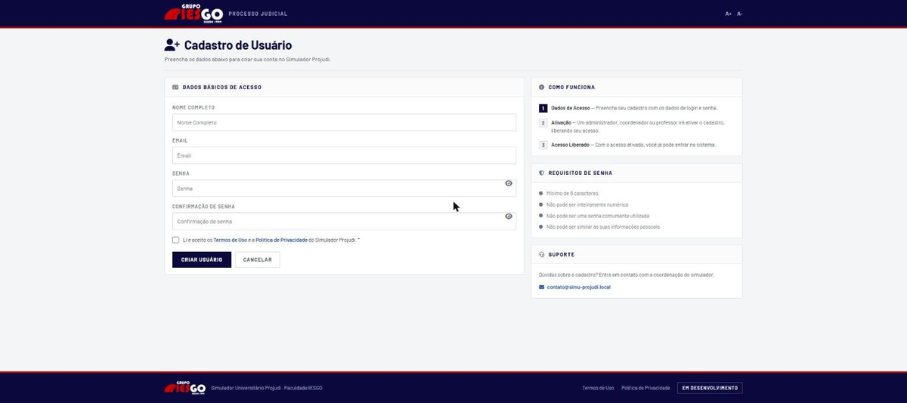

Exemplo de formulário preenchido com dados fictícios:

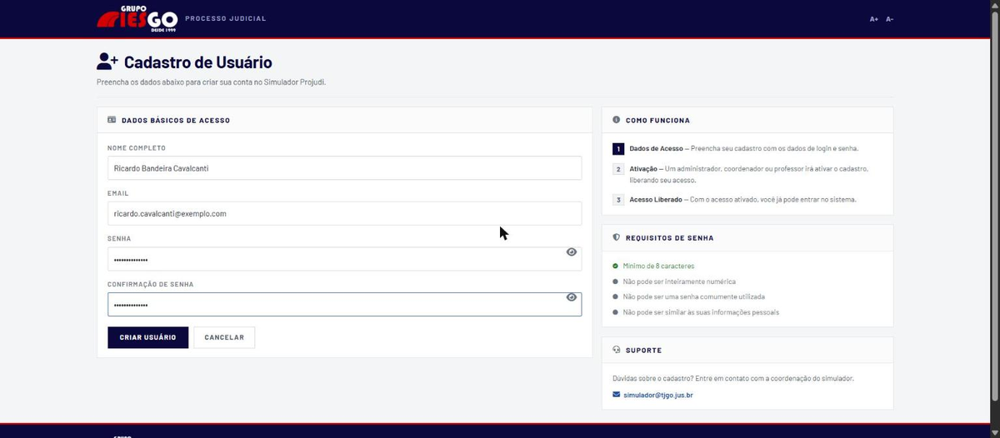

**Resultado:** você volta para a tela de login com a mensagem "Cadastro realizado com sucesso!
Aguarde a aprovação de um responsável para acessar o sistema." Seu cadastro fica com status
**Pendente**: é o **Coordenador/Professor** do seu Núcleo de Prática Jurídica quem confirma sua matrícula e
libera seu acesso, atribuindo seu cargo de simulação dentro de um ciclo.

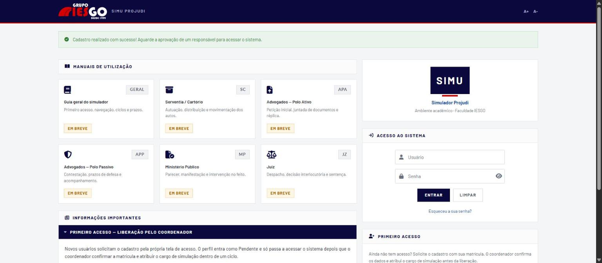

> ⚠️ **Atenção:** enquanto seu cadastro estiver Pendente, se você tentar fazer login o sistema vai
> mostrar a mensagem genérica "Por favor, entre com um usuário e senha corretos". **Isso não
> significa que sua senha está errada**, apenas que seu acesso ainda não foi liberado. Aguarde a
> confirmação do Coordenador antes de tentar novamente.

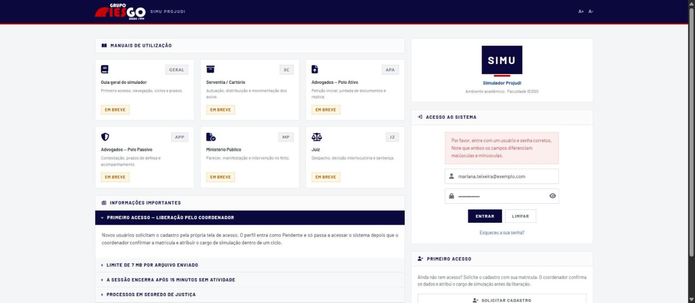

---

### 2. O que Acontece Logo Após o Cadastro

Enquanto o Coordenador do seu Núcleo de Prática Jurídica não confirmar seu cadastro, seu perfil
fica como **Pendente**. Nessa fase:

- Você **não consegue entrar no sistema**: qualquer tentativa de login mostra a mensagem padrão de
  usuário/senha incorretos (ver aviso na seção anterior), mesmo com a senha certa.
- Não existe uma tela específica de "aguardando aprovação" para consultar; o único jeito de saber
  se seu cadastro já foi liberado é tentar fazer login novamente.

---

### 3. Como Fazer Login

*Disponível para: qualquer usuário com cadastro **Ativo** (aprovado por um Coordenador, Admin ou
Professor).*

1. Na tela inicial do simulador, preencha **Usuário** (seu e-mail de cadastro) e **Senha**.
2. Clique em **Entrar**.

**Resultado:** o sistema confere usuário e senha e leva você para a tela inicial do seu perfil (ver
próxima seção, "Para onde cada perfil é redirecionado").

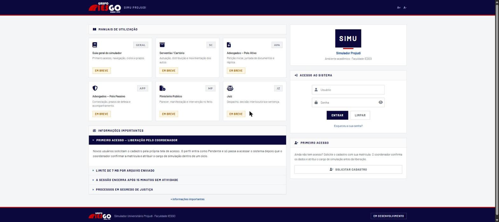

> ⚠️ Se aparecer a mensagem "Por favor, entre com um usuário e senha corretos", confira se digitou
> tudo certo (o sistema diferencia maiúsculas de minúsculas), e lembre que essa mesma mensagem
> aparece também quando o cadastro ainda está Pendente (ver seção anterior).

> ℹ️ Se os Termos de Uso ou a Política de Privacidade forem atualizados depois do seu cadastro, o
> sistema pode pedir para você aceitar a nova versão logo após o login, antes de liberar o resto do
> sistema. Marque a caixa de aceite e clique em **"Continuar"** para prosseguir.

---

> ℹ️ O link **"Esqueceu a sua senha?"**, abaixo do botão Entrar, só abre um aviso explicando que o
> simulador **não envia e-mail de redefinição**: é preciso procurar o coordenador, professor ou
> administrador do ciclo para pedir a redefinição manual (ver ["Redefinir a senha de outro
> usuário"](#admin-aprovar-cadastro), no Capítulo do Admin).

---

### 4. Para onde Cada Perfil é Redirecionado

**Admin, Coordenador e Professor** caem no mesmo lugar: o **Painel de Controle**
(`/acesso/painel-administrativo/`), com a Gestão de Ciclos de Simulação, o Resumo dos Ciclos Ativos
e os atalhos de "Ações Rápidas". A tela é **visualmente idêntica** para os três perfis; o que muda
é o que cada um enxerga e pode fazer dentro dela (ver o capítulo de cada perfil para as
diferenças).

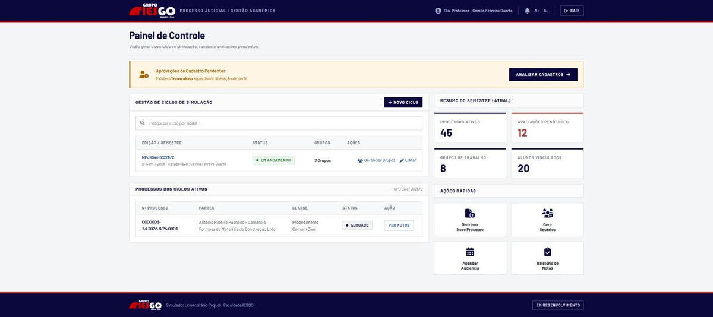

**Aluno**: o destino depende de já estar vinculado a um grupo de trabalho ou não.

- **Ainda sem vínculo a nenhum grupo/ciclo de simulação**: é direcionado a uma tela de
  **Boas-vindas** (`/ciclos/boas-vindas/`) com o aviso "Aguardando Vínculo", explicando que é o
  professor ou o coordenador do ciclo quem inclui o aluno em um grupo de trabalho e define seu
  cargo na simulação. Enquanto isso não acontece, não há processo nenhum para acompanhar.

  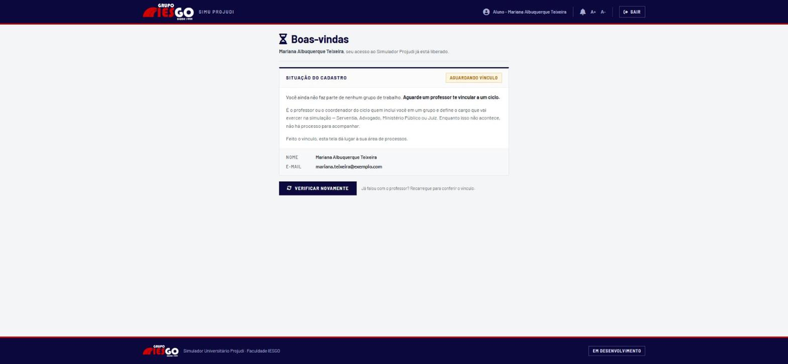

- **Já vinculado a um grupo**: é direcionado direto para a **Área do Aluno**
  (`/processos/area-servidor/`), já mostrando o grupo, o cargo de simulação e os processos
  vinculados.

  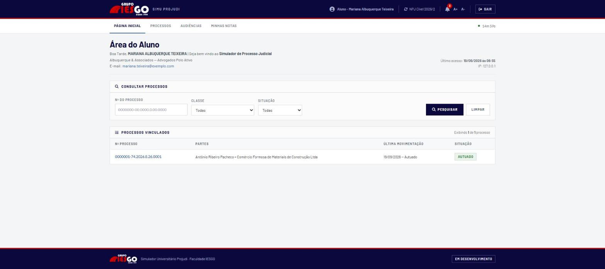

> ℹ️ **Aluno vinculado a mais de um ciclo ao mesmo tempo**: se o Aluno pertence a um grupo de
> trabalho em mais de um ciclo "Em andamento", o login não vai direto para a Área do Aluno: antes
> disso aparece a tela **"Selecione o Ciclo"**, pedindo para escolher em qual dos ciclos deseja
> atuar naquele momento.
>
> 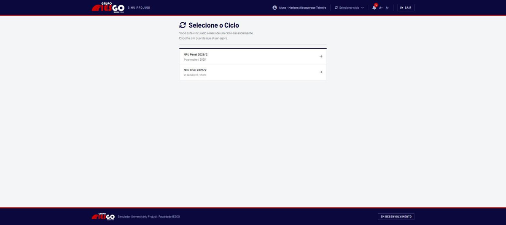
>
> Depois de escolhido, o ciclo ativo fica marcado no cabeçalho (ícone de seta circular, ao lado do
> nome do usuário). Clicando nele, o Aluno pode **trocar de ciclo ativo** a qualquer momento, sem
> precisar sair e logar de novo; o sistema pede para escolher de novo apenas no próximo login.
>
> 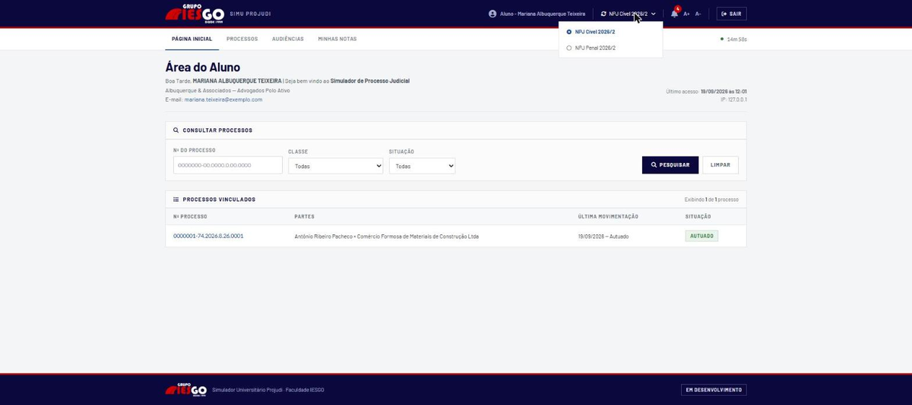
>
> Esse seletor de ciclo no cabeçalho aparece **só para o Aluno**: Admin, Coordenador e Professor
> não precisam dele porque o Painel de Controle deles já mostra todos os seus ciclos de uma vez.

### 5. Como Alterar sua Senha (Minha Conta)

*Disponível para: qualquer perfil logado (Admin, Coordenador, Professor ou Aluno). É a única forma
de troca de senha feita pelo próprio usuário; veja também [Esqueci minha senha](#como-fazer-login),
para quando o usuário não consegue nem fazer login.*

1. Em qualquer tela do sistema, já logado, clique no ícone de cadeado (🔒) no canto superior
   direito do cabeçalho, ao lado do nome do usuário.
2. Na tela **"Minha Conta"**, preencha **Senha Antiga**, **Nova Senha** e **Confirmação da Nova
   Senha**.
3. Clique em **Salvar**.

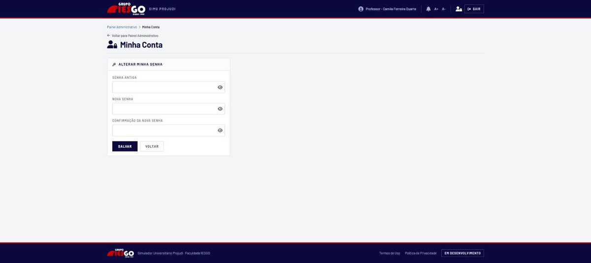

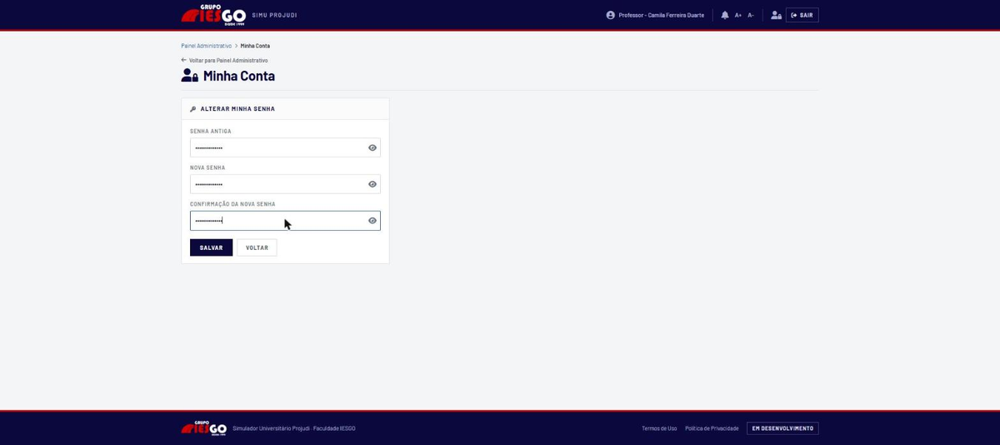

**Resultado:** mensagem de sucesso "Senha alterada com sucesso.", e a sessão **continua ativa**
normalmente (o sistema não derruba o login após a troca).

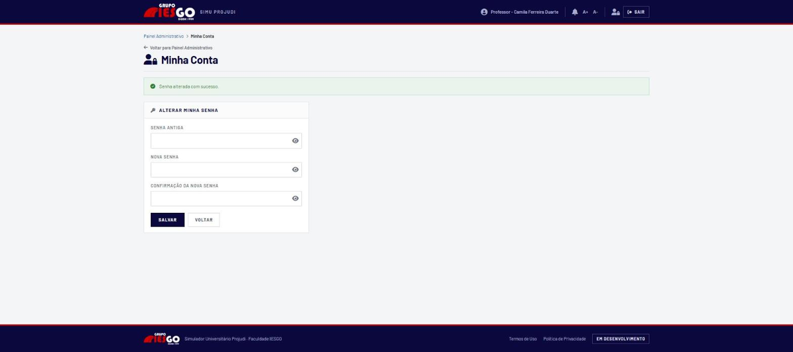

> ⚠️ As mesmas regras de senha do cadastro valem aqui (mínimo de 8 caracteres, não pode ser
> inteiramente numérica, não pode ser uma senha comum, não pode ser parecida com os dados
> pessoais do usuário). Errar a "Senha Antiga" ou digitar confirmações diferentes impede o envio,
> com a mensagem de erro exibida junto ao campo.

---

---

## Capítulo do Admin

*Disponível para: perfil global **Admin**. O Admin é o único perfil com acesso também ao painel
técnico do Django (`/admin/`), usado apenas para dados de configuração do sistema; isso está fora
do escopo deste manual, que cobre a operação normal pela interface do simulador.*

### 1. Painel de Controle

Ao entrar, o Admin é direcionado direto ao **Painel de Controle** (mesma tela do Coordenador e do
Professor; ver capítulos seguintes), com:

- **Gestão de Ciclos de Simulação**: lista os ciclos já criados e o botão para criar um novo.
- **Processos dos Ciclos Ativos**: lista os processos judiciais fictícios em andamento.
- **Resumo dos Ciclos Ativos**: contadores de Processos Ativos, Avaliações Pendentes, Grupos de
  Trabalho e Alunos Vinculados, calculados a partir dos dados reais dos ciclos em andamento
  (o de Avaliações Pendentes some/aumenta conforme movimentações são avaliadas).
- **Ações Rápidas**: **Relatório de Notas**, **Gerir Usuários** e **Avaliações Pendentes**.
- Um aviso amarelo no topo, "Aprovações de Cadastro Pendentes", aparece sempre que houver algum
  cadastro aguardando liberação.

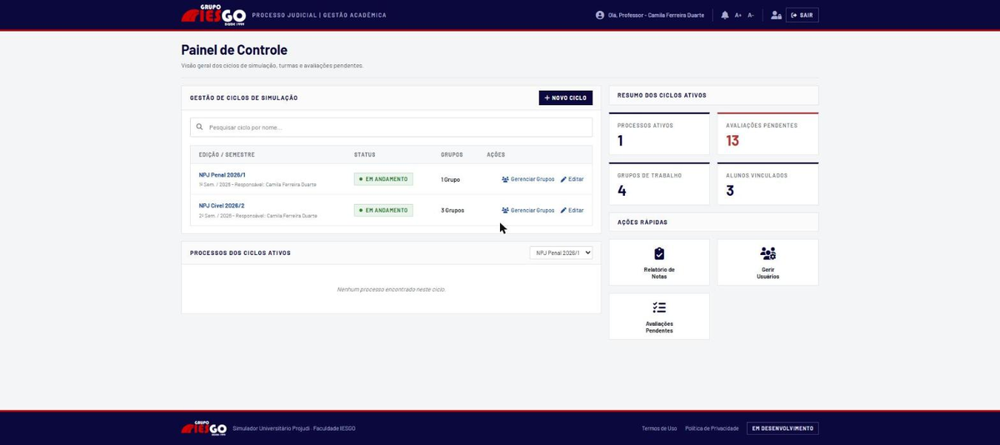

**Relatório de Notas** (`/avaliacoes/relatorio-notas/`) é uma tela própria: mostra, com filtro por
ciclo, o total de alunos e de movimentações avaliadas, a média geral (em estrelas) e uma tabela
"Notas por Aluno" com o total de movimentações, quantas foram avaliadas e a média de cada aluno por
ciclo.

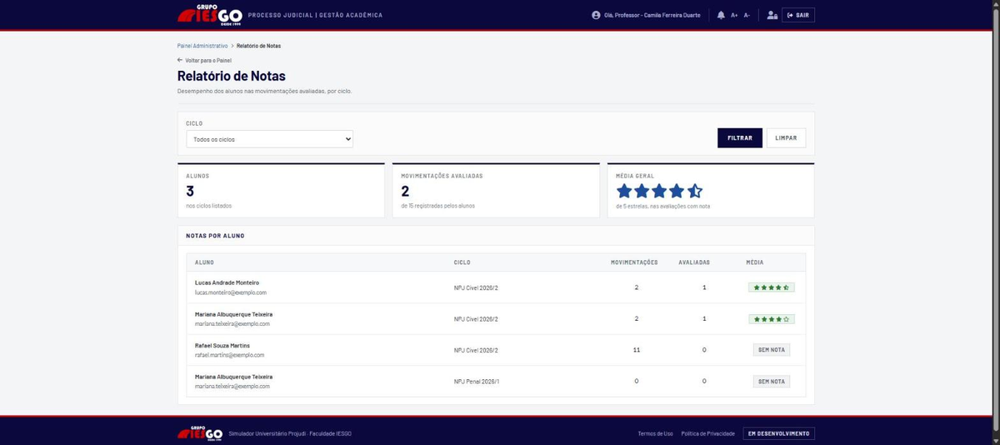

**Avaliações Pendentes** (`/avaliacoes/pendentes/`) lista, com filtro por ciclo, todas as
movimentações registradas que ainda não receberam avaliação de nenhum Professor, da mais antiga
para a mais recente, com um botão **"Avaliar"** em cada linha que leva direto à tela de avaliação
(ver [Capítulo do Professor, seção 3](#professor-avaliar-movimentacao)).

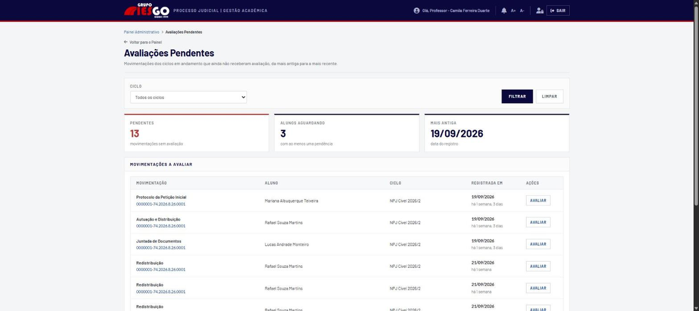

### 2. Como Aprovar um Cadastro Pendente

1. No Painel de Controle, clique em **Analisar Cadastros** (ou em **Gerir Usuários**, nas Ações
   Rápidas).
2. Na aba **Pendentes**, localize o usuário e clique em **Aprovar / Editar**.
3. Escolha o **Tipo de Perfil** (Admin, Coordenador, Professor ou Aluno).

   > ℹ️ As opções de Tipo de Perfil disponíveis dependem da permissão de quem está logado: o Admin
   > vê os quatro perfis, enquanto o Coordenador e o Professor veem uma lista mais restrita (ver o
   > capítulo de cada perfil).
4. Marque a caixa **Ativo (liberar acesso ao sistema)**.
5. Clique em **Salvar**.

**Resultado:** o usuário passa a constar como Ativo na aba "Todos os Usuários" e já consegue fazer
login normalmente, caindo na tela correspondente ao perfil escolhido (ver
["Para onde Cada Perfil é Redirecionado"](#redirecionamento)).

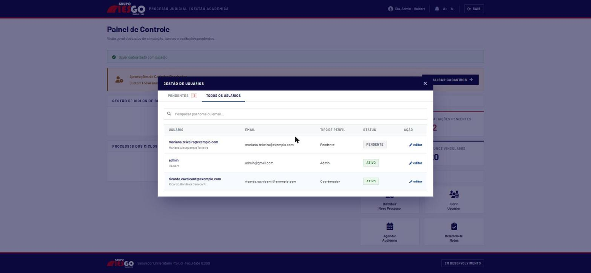

> ⚠️ Os dois campos (perfil e "Ativo") precisam ser preenchidos manualmente: não existe um botão
> único de "aprovar com um clique" que já libera o acesso automaticamente.

**Redefinir a senha de outro usuário:** o mesmo modal "Editar/Aprovar Usuário" tem uma subseção
recolhível **"Alterar Senha"**, útil para destravar alguém que esqueceu a senha (o sistema não
envia e-mail de redefinição pela própria interface).

1. Abra o modal "Editar/Aprovar Usuário" do usuário desejado (mesmos passos acima).
2. Clique em **"Alterar Senha"** para expandir a subseção.
3. Preencha **Nova Senha** e **Confirmação**. Deixe os dois em branco se não quiser alterar a
   senha.
4. Clique em **Salvar**.

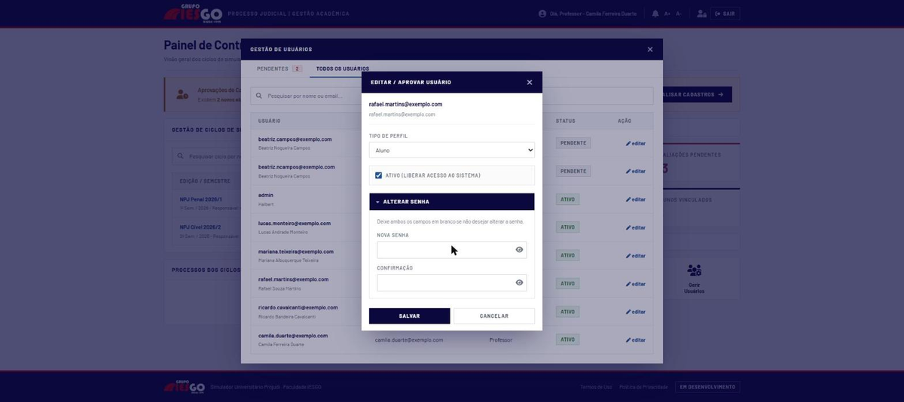

**Resultado:** mensagem "Usuário atualizado com sucesso."; a nova senha passa a valer no próximo
login do usuário afetado.

### 3. Como Criar um Ciclo de Simulação

*Pré-requisito: nenhum. Um Ciclo de Simulação representa um semestre letivo do NPJ.*

1. No Painel de Controle, clique em **+ Novo Ciclo**.
2. Preencha o **Nome/Edição do Ciclo** (ex.: "NPJ Cível 2026/2").
3. Escolha o **Semestre** (1º ou 2º) e confira o **Ano**.
4. Clique em **Salvar Ciclo**.

**Resultado:** o ciclo aparece na lista "Gestão de Ciclos de Simulação", com status **Em
andamento**, e quem criou o ciclo é automaticamente registrado como o "Responsável" por ele.

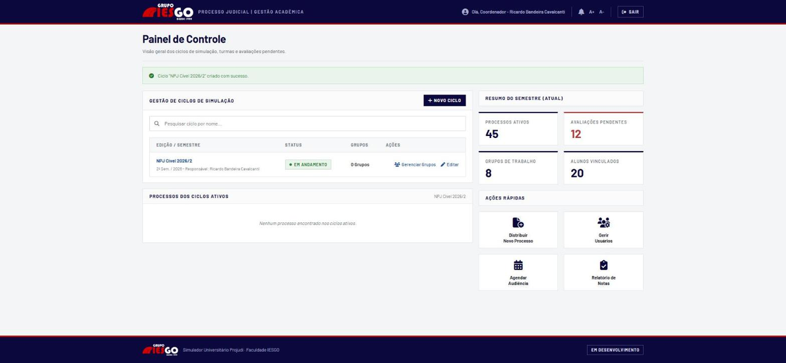

> ⚠️ Não existe campo para escolher outra pessoa como responsável no momento da criação: quem cria
> o ciclo sempre vira o responsável por ele. Para atribuir o ciclo a outro Coordenador ou Professor,
> é preciso **editar** o ciclo depois de criado.

### 4. Como Criar, Editar e Excluir um Grupo de Trabalho, e Adicionar/Remover Alunos

*Pré-requisito: o ciclo já precisa existir. Um Grupo de Trabalho representa uma equipe de alunos
atuando com um papel específico no processo simulado (ex.: um "escritório de advocacia" do Polo
Ativo). Esta tela ("Gerenciar Grupos") é a mesma para Admin, Coordenador e Professor responsável
pelo ciclo: as ações abaixo valem igualmente para os três perfis.*

**Criar um grupo:**

1. Na lista de ciclos, clique em **Gerenciar Grupos** no ciclo desejado.
2. Clique em **+ Novo Grupo**.
3. Preencha o **Nome do Grupo** (ex.: "Albuquerque & Associados") e escolha o **Papel Processual**
   (Serventia/Cartório, Advogados Polo Ativo, Advogados Polo Passivo, Ministério Público ou Juiz).
4. Clique em **Salvar**.

**Adicionar um aluno ao grupo:**

5. Com o grupo selecionado na lista à esquerda, use o campo **Adicionar ao Grupo** para buscar um
   aluno pelo nome ou e-mail, e clique em **+ Add** ao lado do nome dele.

**Resultado:** o aluno passa a fazer parte do grupo e do ciclo. No login seguinte, ele deixa de ver
a tela "Aguardando Vínculo" e passa a ver sua Área do Aluno normalmente, com o grupo e os
processos vinculados a ele.

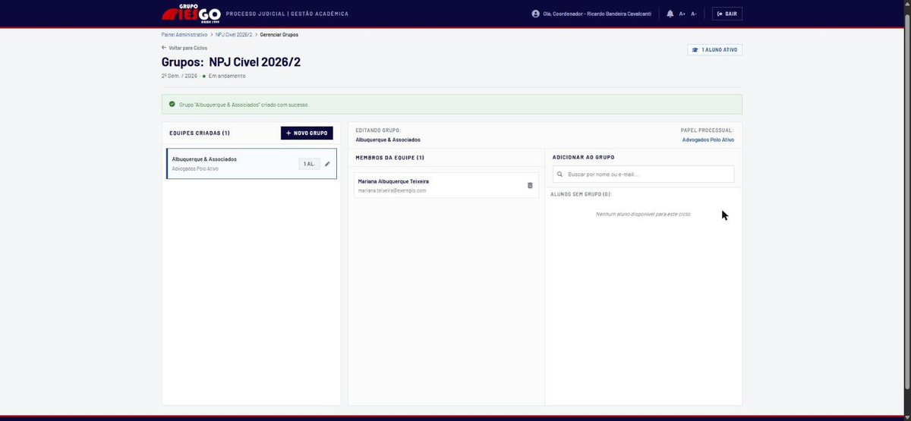

> ⚠️ Um aluno só pode estar em **um grupo por ciclo**: o sistema bloqueia a tentativa de colocá-lo
> em dois grupos do mesmo ciclo ao mesmo tempo.

**Editar um grupo já existente:**

6. Na lista de grupos, clique no ícone de lápis ao lado do grupo desejado.
7. No modal "Editar Grupo", altere o **Nome do Grupo** e/ou o **Papel na Simulação** livremente
   (o sistema não impede a troca de papel mesmo que o grupo já tenha alunos vinculados).
8. Clique em **Salvar**.

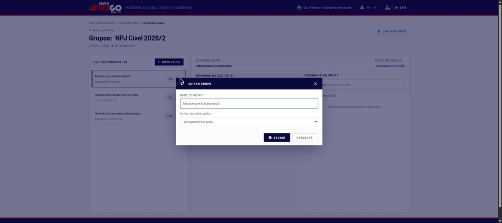

**Remover um aluno de um grupo:**

9. Com o grupo selecionado, clique no ícone de lixeira ao lado do nome do aluno em "Membros da
   Equipe".

**Resultado:** o aluno é removido do grupo imediatamente, **sem pedir confirmação**. Se esse era o
único grupo do aluno naquele ciclo, ele também é desvinculado do ciclo (volta a ver "Aguardando
Vínculo" no próximo login); se o aluno participa de outro grupo do mesmo ciclo, ele continua
vinculado ao ciclo por esse outro grupo.

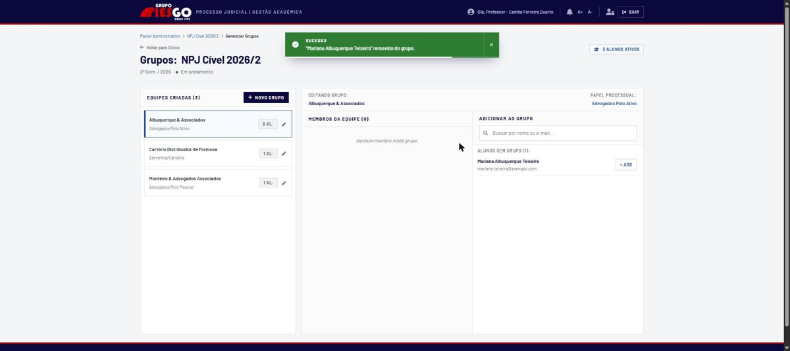

> ⚠️ **Não existe função para excluir um grupo inteiro.** A tela "Gerenciar Grupos" permite criar,
> editar (nome e papel) e remover alunos um a um, mas não há botão nem opção para apagar um Grupo
> de Trabalho já criado. Para "esvaziar" um grupo, é preciso remover seus alunos um a um.

---

## Capítulo do Coordenador

*Disponível para: perfil global **Coordenador**.*

O Painel de Controle do Coordenador é **idêntico** ao do Admin (mesmas seções: Gestão de Ciclos,
Resumo do Semestre, Ações Rápidas); todos os passos do [Capítulo do Admin](#capitulo-admin) valem
também para o Coordenador: aprovar cadastros, criar ciclos, criar/editar grupos e adicionar/remover alunos dos grupos.

Ao aprovar ou editar um usuário, o Coordenador **não pode atribuir o perfil "Admin"** a
ninguém: o seletor de Tipo de Perfil só oferece Coordenador, Professor e Aluno. Já o Admin pode
atribuir qualquer um dos quatro perfis.

*(Não há diferença de permissão a confirmar em "Distribuir Novo Processo" ou "Agendar
Audiência": como descrito no [Capítulo do Admin, seção 1](#admin-painel), essas duas ações não têm
nenhuma tela implementada por trás; a limitação é a mesma para qualquer perfil que acesse o
Painel de Controle, não uma questão de permissão do Coordenador.)*

---

---

## Capítulo do Professor

*Disponível para: perfil global **Professor**.*

O Professor usa o **mesmo Painel de Controle** dos outros perfis de gestão, mas com um recorte bem
mais restrito: ele só enxerga e administra os ciclos dos quais é responsável.

### 1. O que o Professor vê no Painel de Controle

- **Gestão de Ciclos de Simulação**: mostra **apenas os ciclos em que o Professor é o
  "Responsável"**, não a lista completa de ciclos do sistema, como no Admin/Coordenador. Um
  Professor recém-aprovado, sem nenhum ciclo atribuído a ele, vê "Nenhum ciclo de simulação
  cadastrado", mesmo que existam outros ciclos ativos no sistema.

  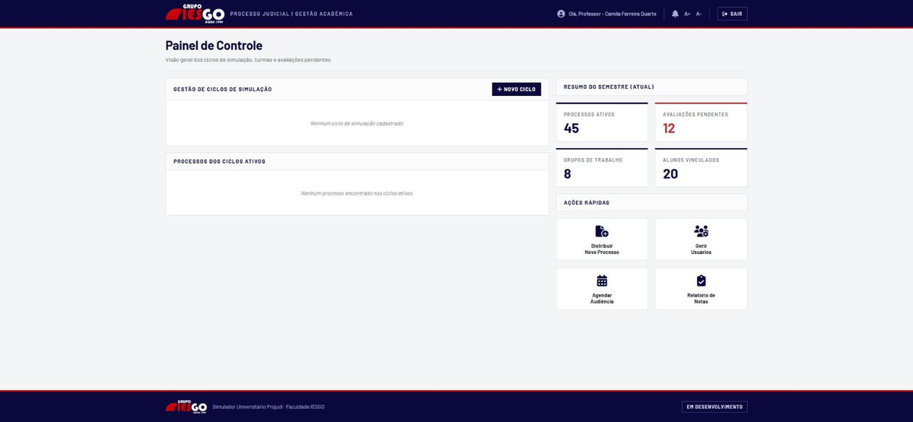

- Assim que um Coordenador (ou Admin) atribui o Professor como "Responsável" de um ciclo
  (pela tela de **editar ciclo**), esse ciclo passa a aparecer normalmente para o Professor, com os
  mesmos botões "Gerenciar Grupos" e "Editar" que o Coordenador tem.

  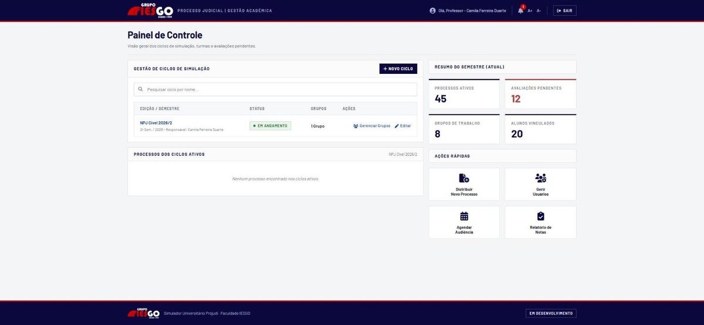

- **Gerir Usuários**: o Professor consegue ver a lista completa de usuários do sistema, mas só pode
  **aprovar ou editar cadastros atribuindo o perfil Aluno**, ao contrário do Coordenador (que pode
  atribuir Coordenador, Professor ou Aluno) e do Admin (que pode atribuir qualquer perfil).

  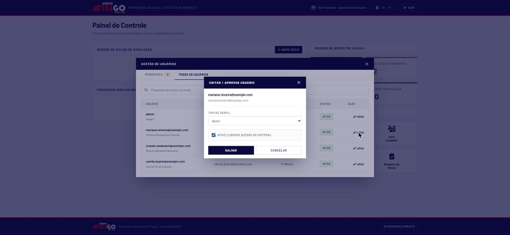

> ⚠️ Um Professor **não recebe automaticamente** os ciclos criados por outras pessoas. Se um
> Coordenador criar um ciclo, o Professor só vai enxergá-lo depois que alguém (Admin ou
> Coordenador) o atribuir como Responsável daquele ciclo, na tela de editar.

### 2. Como Vincular um Aluno a um Grupo de Trabalho

Depois de aprovar o cadastro de um Aluno (Painel de Controle → "Analisar Cadastros" → aprovar com o
Tipo de Perfil "Aluno" e marcar "Ativo"), o Aluno ainda não pertence a nenhum grupo: ele só passa
a ver processos e movimentações depois de ser colocado em um Grupo de Trabalho do ciclo.

1. No Painel de Controle, clique em **"Gerenciar Grupos"** na linha do ciclo desejado (a mesma tela
   usada para [criar um Grupo de Trabalho](#admin-criar-grupo)).
2. Clique no grupo já existente ao qual o Aluno deve pertencer (ou crie um novo grupo com
   "+ Novo Grupo", escolhendo o **Papel na Simulação**: Serventia/Cartório, Advogados Polo Ativo,
   Advogados Polo Passivo, Ministério Público ou Juiz).
3. À direita, em **"Adicionar ao Grupo"**, a lista **"Alunos sem Grupo"** mostra apenas os alunos do
   ciclo que ainda não foram colocados em nenhuma equipe. Clique em **"+ ADD"** ao lado do nome do
   aluno desejado.
4. O aluno aparece imediatamente em **"Membros da Equipe"**, e o contador de alunos do grupo (no
   painel esquerdo) é atualizado.

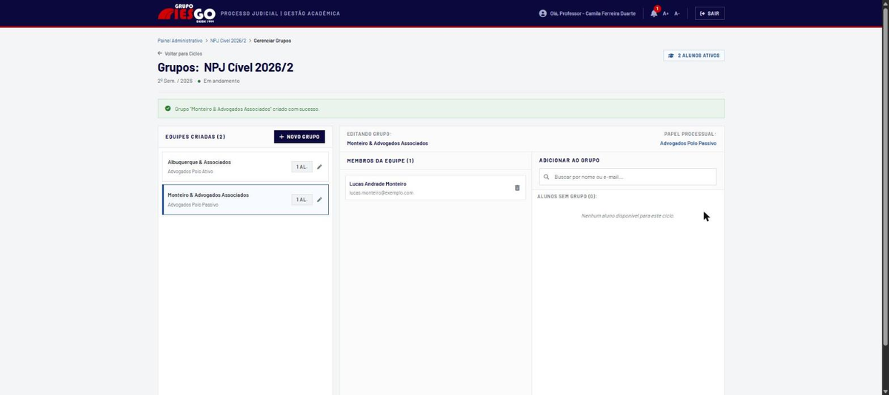

A partir desse momento, ao logar, o aluno passa a ver na "Área do Aluno" todos os processos
vinculados ao grupo dele, podendo movimentar e visualizar os autos conforme o papel processual do
grupo (Advogado, Serventia, Ministério Público ou Juiz).

Nessa mesma tela também é possível **editar** o grupo (nome e papel, pelo ícone de lápis) e
**remover** um aluno do grupo (ícone de lixeira ao lado do nome dele, sem pedir confirmação); veja
os detalhes na [seção 4 do Capítulo do Admin](#admin-criar-grupo). Não existe opção para excluir
um grupo inteiro.

> ℹ️ Um aluno só pode pertencer a **um grupo por vez** dentro do mesmo ciclo; por isso a lista
> "Adicionar ao Grupo" só mostra quem ainda está sem grupo.

### 3. Como Avaliar uma Movimentação (Atribuir Nota)

Sempre que um aluno registra uma movimentação em um processo, ela fica disponível para avaliação do
Professor responsável pelo ciclo. Há dois caminhos para chegar até a tela de avaliação:

- Pela página **"Avaliações Pendentes"** (Painel de Controle → atalho "Avaliações Pendentes"),
  que lista todas as movimentações ainda sem avaliação de todos os ciclos do Professor, da mais
  antiga para a mais recente, com um botão **"Avaliar"** em cada linha.
- Pelo próprio processo: abra o processo (Painel de Controle → "Ver Autos" na linha do processo,
  ou pela lista de processos do ciclo), role até a aba **"Eventos do Processo"** e, na coluna
  "Opções" de cada linha da movimentação, use o menu **"⋮"** (diferente do ícone de lápis que
  aparece para quem registrou a movimentação) e escolha **"Avaliar"**.

A tela "Avaliação de Movimentação" mostra os dados completos da movimentação: autor, grupo
responsável, tipo, data/hora e a descrição do evento.

Em **"Nota e Feedback"**, preencha:

- **Avaliação (1 a 5 estrelas)**: clique na estrela correspondente. Sem estrelas marcadas = sem
  nota (é assim que o Professor consegue enviar um comentário sem atribuir avaliação). O link
  "Limpar" zera a seleção.
- **Comentário ao Aluno**: texto livre, explicitamente marcado como "visível para" o aluno autor
  da movimentação.

Depois de preencher, há três botões:

- **"Concluir Avaliação"**: abre uma caixa de confirmação resumindo o aluno e a nota (em estrelas)
  antes de enviar definitivamente: clique em **"Confirmar e Enviar"**.
- **"Devolver para Revisão"**: grava o comentário sem atribuir nota.

  *(Seção em elaboração: descrição detalhada do fluxo de devolução para revisão.)*
- **"Voltar"**: sai da tela sem salvar nada.

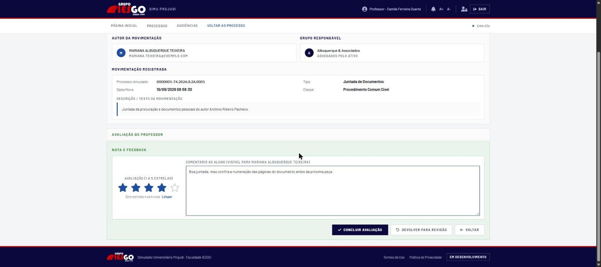

### 4. Como Bloquear/Desativar um Cadastro

O mesmo formulário usado para aprovar um cadastro também serve para bloquear o acesso de alguém já
ativo.

1. Painel de Controle → **"Gerir Usuários"** → aba **"Todos os Usuários"**.
2. Clique em **"editar"** na linha do usuário a ser bloqueado.
3. Desmarque a caixa **"Ativo (liberar acesso ao sistema)"** e clique em **"Salvar"**.

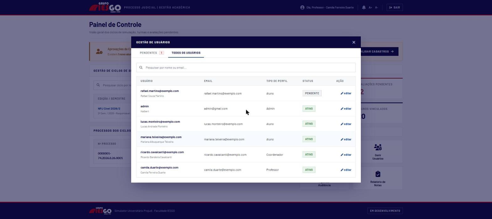

Ao tentar logar, o usuário bloqueado recebe a mesma mensagem genérica usada para qualquer erro de
login ("Por favor, entre com um usuário e senha corretos"), mesmo digitando a senha correta: o
sistema não informa que a conta foi desativada.

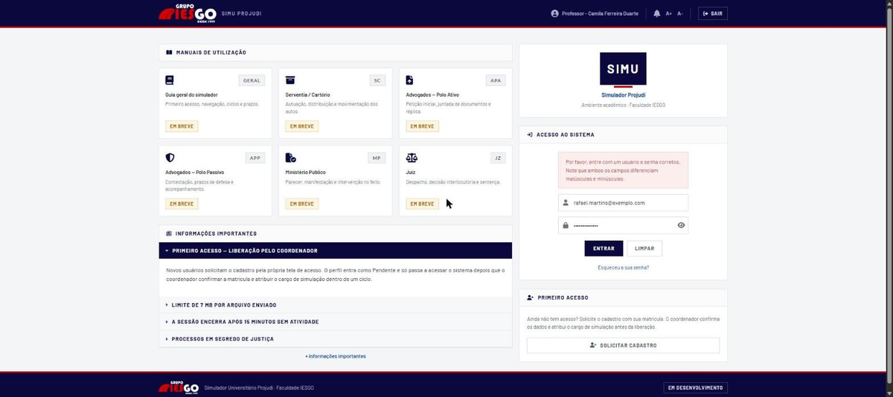

> ℹ️ O Professor só pode bloquear/reativar cadastros do tipo **Aluno**. Bloquear um Coordenador
> ou outro Professor exige o perfil Admin ou Coordenador.

---

## Capítulo do Aluno

*Disponível para: perfil global **Aluno**.*

### 1. Para onde o Aluno é redirecionado, dependendo do vínculo

O que o Aluno vê depende de já ter sido colocado em um grupo de trabalho de um ciclo ou não:

- **Aluno aprovado mas ainda sem grupo**: ao logar, é redirecionado para `/ciclos/boas-vindas/`, com um cartão
  "Situação do Cadastro: Aguardando Vínculo" explicando que é o Professor ou o Coordenador do
  ciclo quem inclui o aluno em um grupo e define o cargo de simulação (Serventia, Advogado,
  Ministério Público ou Juiz).

  

- **Aluno já vinculado a um grupo de trabalho**: ao logar, é direcionado direto para a "Área do Aluno"
  (`/processos/area-servidor/`), já mostrando o nome do grupo e o cargo processual do grupo no
  cabeçalho (por exemplo, "Albuquerque & Associados, Advogados Polo Ativo").

> ⚠️ Só quem inclui o Aluno em um grupo é o Professor responsável pelo ciclo ou o Coordenador:
> o Aluno não escolhe nem solicita entrar em um grupo pela própria tela.

### 2. Área do Aluno: visão geral

A página inicial do Aluno mostra, no topo, o nome do grupo e o cargo processual, e logo abaixo um
bloco "Consultar Processos" (busca por número/classe/situação) e uma lista "Processos Vinculados".
Enquanto nenhum processo foi distribuído para o grupo, a lista aparece vazia, com a mensagem
"Nenhum processo vinculado ao seu usuário.".

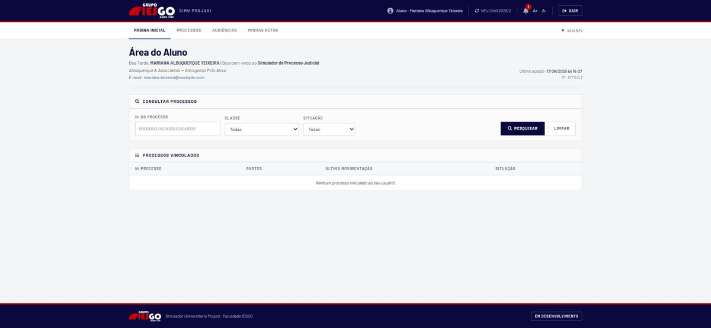

O menu superior do Aluno tem 4 itens: **Página Inicial**, **Processos**, **Audiências** e
**Minhas Notas**.

### 3. Menu "Processos"

O menu "Processos" abre um submenu com duas opções:

- **Cadastrar Processos**: leva a um formulário funcional de "Cadastro de Processo Comum", em 3
  passos (Dados do Processo → Documentos → Resumo), já mostrando o ciclo ativo do aluno no topo
  ("Ciclo ativo: NPJ Cível 2026/2, 2º/2026"). Documentado em detalhe na seção [7. Como Cadastrar
  um Processo](#aluno-cadastrar-processo), mais adiante neste capítulo.
- **Consultar Todos**: ainda não disponível nesta versão do sistema.

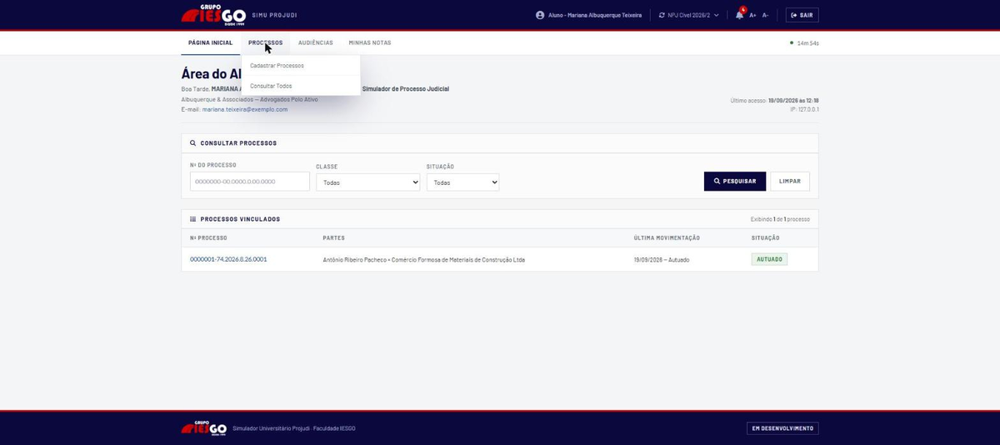

### 4. Menu "Audiências"

*(Seção em elaboração: funcionalidade em desenvolvimento.)*

### 5. "Minhas Notas"

"Minhas Notas" é um link funcional (`/avaliacoes/minhas-notas/`) e mostra o painel "Meu Desempenho"
do Aluno: nome/e-mail, três indicadores (Média Geral, Avaliadas, Melhor Avaliação, todos em
estrelas de 1 a 5) e um "Histórico de Avaliações". Sem nenhuma movimentação avaliada ainda, os
indicadores aparecem como "—"/"0" e o histórico mostra "Nenhuma avaliação recebida ainda.".

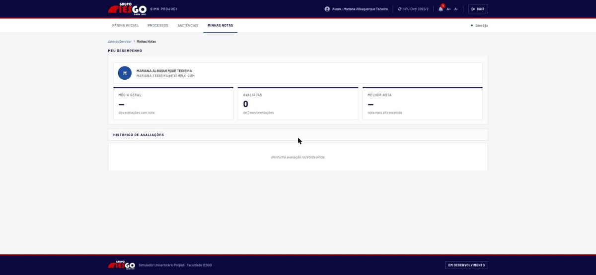

Depois que o Professor [avalia uma movimentação](#professor-avaliar-movimentacao), essa mesma tela
passa a mostrar a avaliação real: os três indicadores são preenchidos, aparece um aviso de "Última
avaliação" (com professor, movimentação e estrelas) e a tabela "Histórico de Avaliações" lista cada
movimentação avaliada, com abas para filtrar "Todas" / "Com Nota" / "Sem Nota" e um ícone de "olho"
para reabrir o comentário completo do professor.

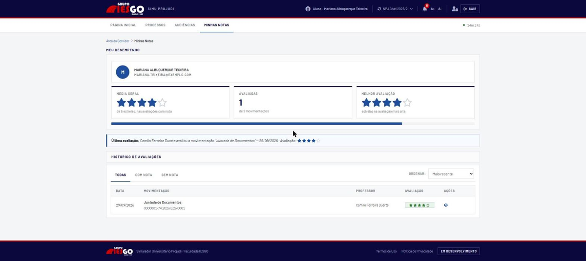

### 6. Notificações

O sino de notificações no cabeçalho mostra um contador (badge) com a quantidade de notificações
não lidas. Ao clicar, abre um painel com as notificações recentes: por exemplo, o próprio evento
de ter sido adicionado a um grupo aparece como notificação: *"Você foi adicionado ao ciclo 'NPJ
Cível 2026/2'."*, com a marcação de há quanto tempo (ex.: "18 minutos atrás") e um link "Ver
todas".

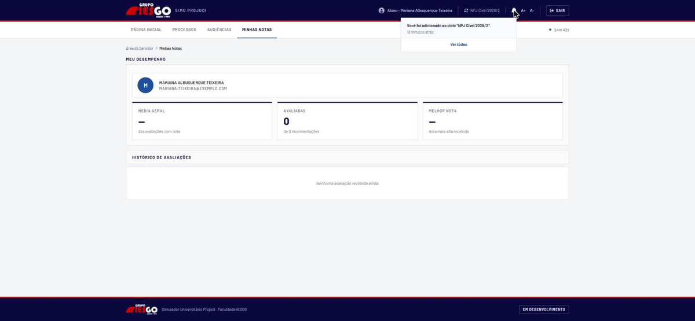

Outros eventos também geram notificação para o Aluno: o grupo dele ser vinculado a um processo
("Seu grupo foi vinculado ao processo '...' como Advogados Polo Passivo") e uma nova movimentação
ocorrer em um processo do qual participa ("Nova movimentação em '...': Autuação e Distribuição").
A página completa de notificações (`/notificacoes/`, acessível pelo link "Ver todas") lista todo o
histórico, mais recente primeiro.

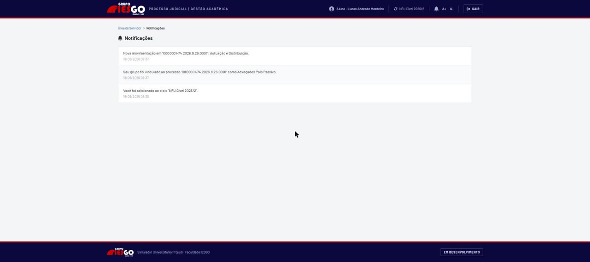

> Uma visão comparativa de notificações em outros perfis (Professor/Coordenador) e uma observação
> importante sobre o que **não** gera notificação está na seção [Notificações do
> Sistema](#notificacoes-sistema), ao final deste capítulo.

### 7. Como Cadastrar um Processo

O item "Cadastrar Processos" do menu "Processos" abre um formulário funcional de 3 passos.

**Passo 1 (Dados do Processo)**: Tipo do Processo, Comarca, Vara/Serventia, Classe Processual,
Valor da Causa (com opção de marcar Segredo de Justiça) e as partes do processo (Polo Ativo, Polo
Passivo e, opcionalmente, Substituto Processual/Outras Partes). Para cada polo, é possível buscar
uma parte já cadastrada ou clicar em "+ Cadastrar Nova" para criar uma parte fictícia na hora
(Nome/Razão Social, CPF/CNPJ e Tipo de Pessoa: Física ou Jurídica). A Vara/Serventia só mostra as
varas da Comarca escolhida.

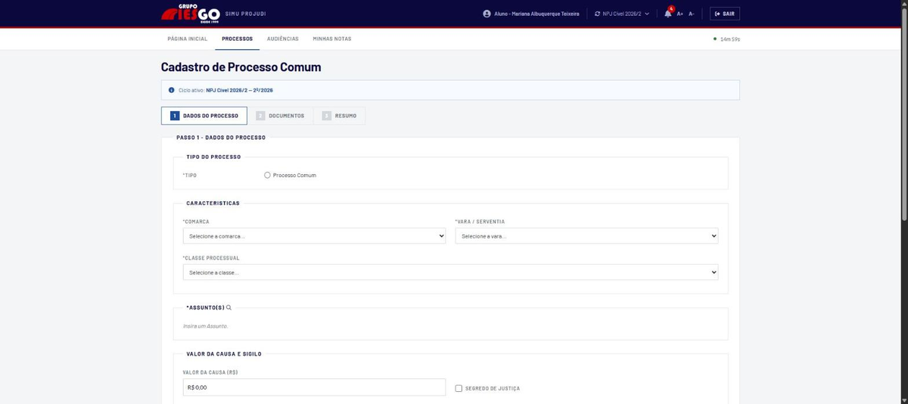

**Passo 2 (Documentos)**: permite anexar arquivos ao processo (PDF, DOCX, JPG, JPEG, até 7 MB por
arquivo), mas **não é obrigatório**: dá para avançar sem anexar nada.

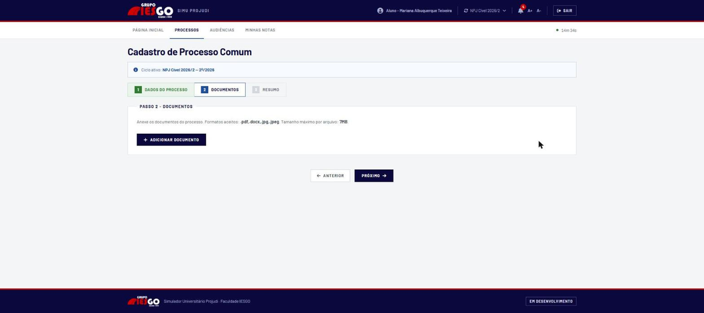

**Passo 3 (Resumo)**: mostra um resumo de conferência (dados do processo, partes e documentos)
antes de confirmar. Ao clicar em "Cadastrar Processo", o sistema gera automaticamente o número do
processo no padrão CNJ (`NNNNNNNN-DD.AAAA.J.TR.OOOO`): o usuário não digita esse número.

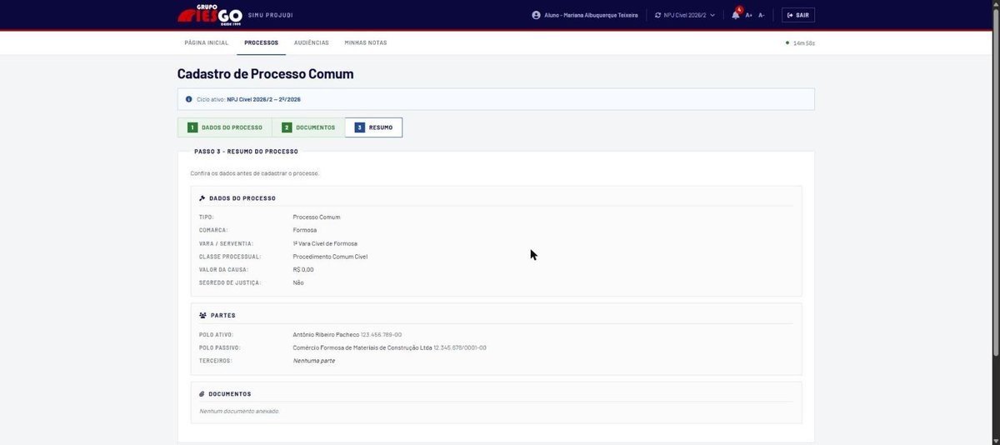

O processo cadastrado aparece imediatamente na lista "Processos Vinculados" da Área do Aluno, com
situação "Protocolado".

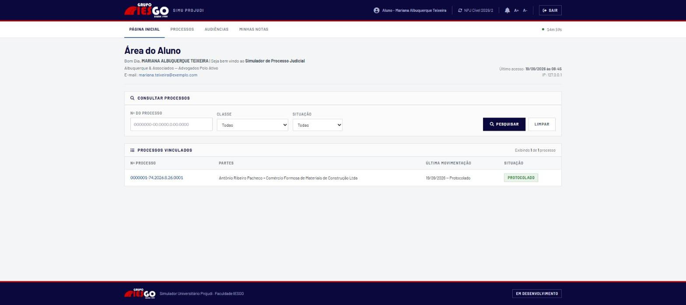

### 8. Detalhe do Processo

Ao clicar no número do processo na lista, abre a tela "Autos", com os dados completos do processo
(polos, vara/comarca, classe, valor da causa, status, ciclo e grupos vinculados) e, logo abaixo, três
abas: **Eventos do Processo** (linha do tempo das movimentações), **Índice Processo** e **Navegação
de Arquivo**.

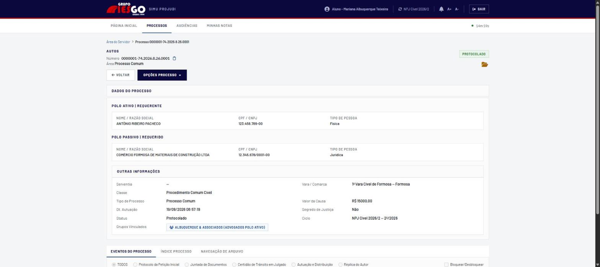

O botão "Opções Processo" abre um menu com as ações disponíveis para o Aluno/Advogado do grupo:
**Marcar Audiência**, **Partes**, **Visualizar** e **Movimentar**. A opção **"Modificar Dados"**
aparece desabilitada para esse perfil.

*(Seção em elaboração: "Marcar Audiência" ainda em desenvolvimento.)*

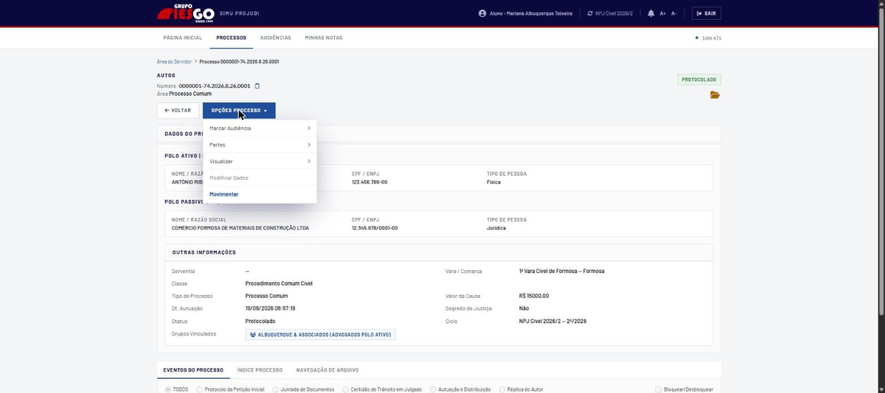

### 9. Como Movimentar um Processo

Em "Opções Processo → Movimentar", o formulário pede o **Tipo de Movimentação** (lista suspensa,
com a observação "Preencher conforme TPU CNJ para alimentar estatística de produtividade"), uma
descrição livre e, opcionalmente, documentos anexados. Também é feito em 2 passos, com uma tela de
revisão antes de confirmar.

> ⚠️ Os tipos de movimentação disponíveis no formulário mudam conforme o papel processual de quem
> está logado. Para um Aluno do grupo "Advogados Polo Ativo", só aparece a opção **"Juntada de
> Documentos"**.

Depois de confirmada, a movimentação aparece na aba "Eventos do Processo" do detalhe do processo,
junto com a movimentação automática "Protocolo da Petição Inicial" gerada no momento do cadastro;
cada evento mostra número sequencial, descrição, data/hora e o usuário responsável.

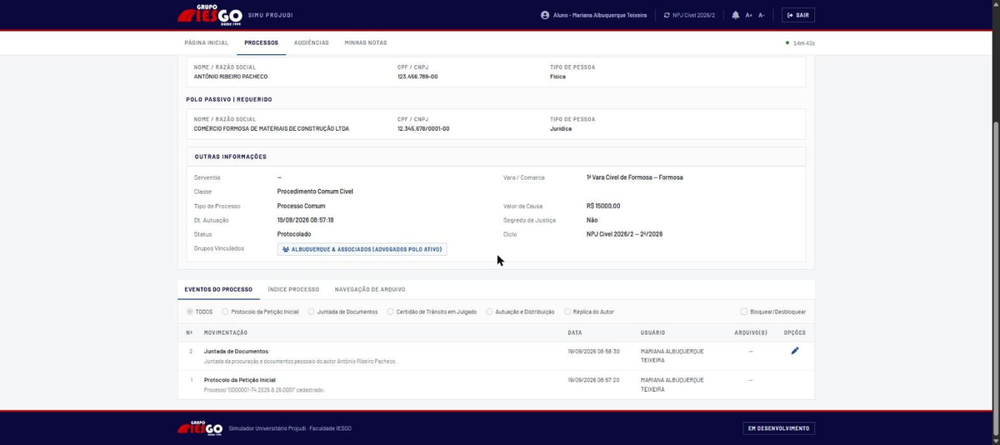

### 10. Como Anexar um Documento em uma Movimentação

No **Passo 1** de "Movimentar Processo", a seção "Documentos da Movimentação" tem duas abas:
"Upload de Arquivos" e "Modelos, Editor On-line" (coberto na próxima seção). Para anexar um arquivo
já pronto (PDF, DOC, DOCX, ODT, JPG ou PNG, até 10MB):

1. Arraste o arquivo para a área pontilhada, ou clique nela para abrir o seletor de arquivos do
   sistema operacional.
2. Depois do upload, o sistema pede um **"Título do Arquivo"** para cada documento (obrigatório)
   antes de incluí-lo na lista, confirmando com o ícone de "✓".
3. O documento passa a aparecer em **"Documentos a Anexar"**, com opções de editar o título (lápis)
   ou remover (lixeira).
4. Clique em **"Avançar"**, confira o resumo no Passo 2 e clique em **"Confirmar Movimentação"**.

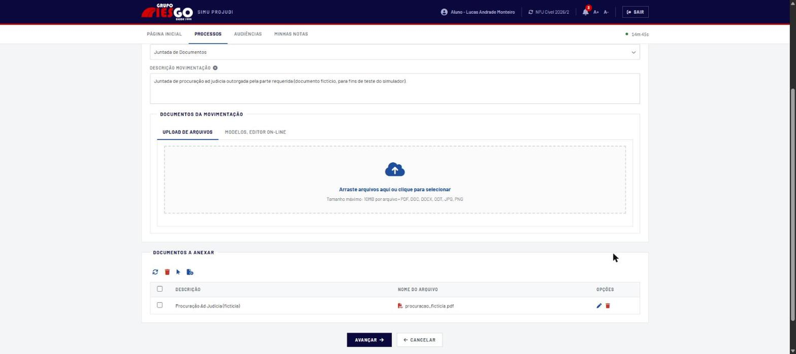

Depois de confirmada, o documento aparece anexado à movimentação na aba "Eventos do Processo": o
número de arquivos aparece na coluna "Arquivo(s)" (ex.: "˅ 1"); clique na seta para expandir e ver
o(s) documento(s) daquele evento, com botões **"Visualizar"** (abre em nova aba) e **"Baixar"**.

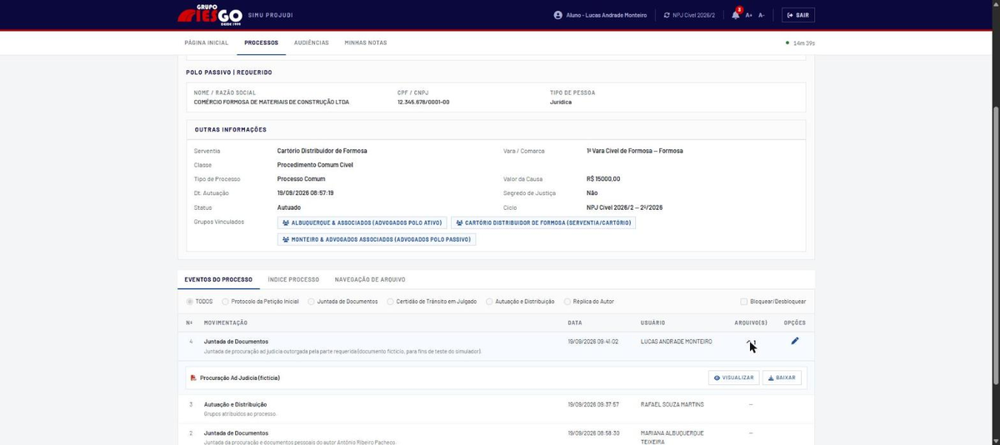

> ℹ️ Não existe, por enquanto, uma tela central que liste "todos os documentos do processo" fora do
> contexto de cada movimentação: para juntar as peças de um processo é preciso abrir cada evento
> na aba "Eventos do Processo".
>
> *(Seção em elaboração: aba "Navegação de Arquivo".)*

### 11. Como Usar o Editor On-line para Criar e Assinar um Documento

A aba **"Modelos, Editor On-line"** (ao lado de "Upload de Arquivos", no mesmo Passo 1 de
"Movimentar Processo") permite redigir um documento diretamente no navegador, sem precisar montar
um arquivo antes.

1. Clique na aba **"Modelos, Editor On-line"**.
2. Opcionalmente, escolha um **modelo de documento** pronto no seletor "Carregar Modelo de
   Documento" (ou continue de um **rascunho salvo** anteriormente, com "Abrir Rascunho (.html)"):
   qualquer um dos dois **substitui o conteúdo atual do editor**.
3. Preencha o **"Nome do Arquivo para Salvar"**.
4. Escreva o texto no editor (formatação de texto rico: negrito, itálico, listas, tabelas, links,
   imagens, alinhamento etc.; barra de ferramentas parecida com um processador de texto comum).
5. No rodapé do editor há três botões:
   - **"Assinar"**: insere automaticamente, ao final do texto, um bloco "ASSINADO
     ELETRONICAMENTE" com o nome do usuário logado e a data/hora, simulando uma assinatura
     eletrônica.
   - **"Incluir na Movimentação"**: adiciona o conteúdo atual do editor à lista de "Documentos a
     Anexar" da movimentação (mesma lista usada pelo upload de arquivos).
   - **"Salvar Rascunho"**: guarda o conteúdo sem incluir na movimentação, para continuar depois.

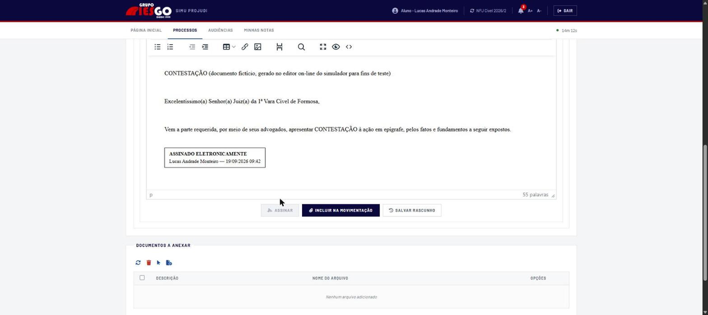

6. Depois de clicar em "Assinar" (opcional, mas recomendado antes de protocolar uma peça) e depois
   em **"Incluir na Movimentação"**, o documento aparece em "Documentos a Anexar" com a extensão
   `.html`; o restante do fluxo (Avançar → Revisão → Confirmar Movimentação) é idêntico ao do
   upload de arquivo comum.

> ⚠️ A assinatura eletrônica do editor é **apenas simbólica** (só insere um texto no próprio
> documento), não é uma assinatura digital com certificado, nem gera nenhum arquivo separado de
> verificação.

### 12. Papel de Serventia/Cartório (SC): Vincular um Grupo a um Processo

Vincular um **segundo grupo** (por exemplo, o time de advogados da parte contrária) a um processo
que já foi protocolado **não é feito pelo Professor nem pelo próprio grupo interessado**: é uma
ação exclusiva de quem pertence a um grupo com o papel processual **"Serventia/Cartório" (SC)**,
feita pela própria "Área do Aluno" desse usuário.

Logado como um aluno de um grupo com papel "Serventia/Cartório", a "Área do Aluno" lista **todos
os processos do ciclo** (não só os do seu próprio grupo) em "Processos da Vara", com uma coluna
extra de checkbox e uma coluna "Ações". Há dois jeitos de abrir o modal **"Atribuir Grupo ao
Processo"**:

- **Um processo por vez**: clique no ícone de pessoas ("Atribuir grupo") na linha do processo
  desejado.
- **Vários processos de uma vez**: marque o checkbox de cada processo (ou o checkbox do
  cabeçalho, para marcar todos) e clique em **"Atribuir grupo aos selecionados"**, no rodapé da
  lista. O modal então se aplica à atribuição em lote nos processos marcados.

Dentro do modal, cada grupo do ciclo aparece como um cartão:

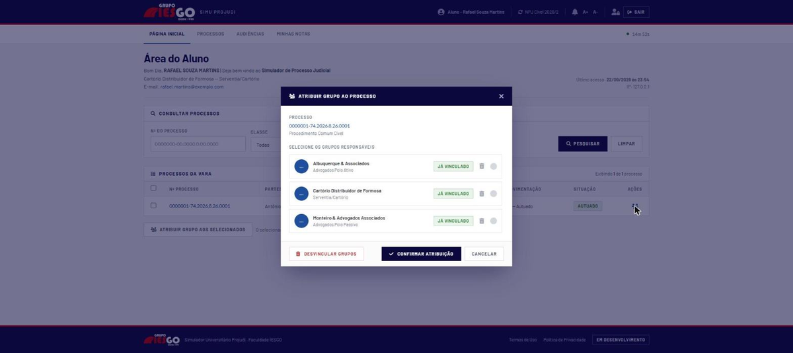

1. Clicar no **corpo do cartão** marca aquele grupo para ser adicionado ao(s) processo(s) aberto(s)
   no modal. Se o papel processual do grupo já estiver ocupado por outro grupo em algum dos
   processos (por exemplo, já existe um Polo Ativo diferente), o sistema pede confirmação antes de
   tratar como uma troca (exceto para o papel Serventia/Cartório, que pode ter mais de um grupo no
   mesmo ciclo sem conflito).
2. Um grupo já vinculado mostra a etiqueta "Já vinculado" (um único processo aberto no modal) ou
   "Em X de Y"/"Em todos os Y" (atribuição em lote), e ganha um ícone de **lixeira** ao lado: clicar
   nele marca aquele grupo específico para ser desvinculado, pedindo confirmação antes. É possível
   desmarcar a remoção clicando de novo na lixeira, antes de confirmar.

   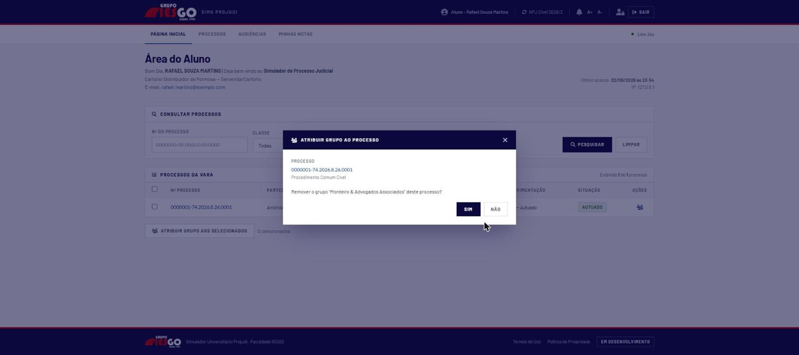
3. O botão **"Desvincular Grupos"**, no rodapé do modal, continua existindo como ação separada: ele
   desvincula **todos** os grupos do(s) processo(s) aberto(s) de uma vez, com sua própria
   confirmação.
4. Depois de marcar as inclusões, trocas e remoções desejadas, clique em **"Confirmar Atribuição"**
   para gravar tudo de uma vez.

Depois de confirmado, o campo "Grupos Vinculados" do processo passa a mostrar todos os grupos
atribuídos, incluindo o próprio grupo de Serventia/Cartório que fez a atribuição e, se ainda não
houvesse serventia definida, o campo "Serventia" do processo é preenchido automaticamente com o
nome desse grupo. O status do processo também pode avançar automaticamente (por exemplo, de
"Protocolado" para "Autuado"). A atribuição também registra sozinha um evento na aba "Eventos do
Processo": **"Autuação e Distribuição"** na primeira atribuição de grupos do processo, ou
**"Redistribuição"** nas atribuições seguintes (inclusive quando a mudança é só uma remoção).

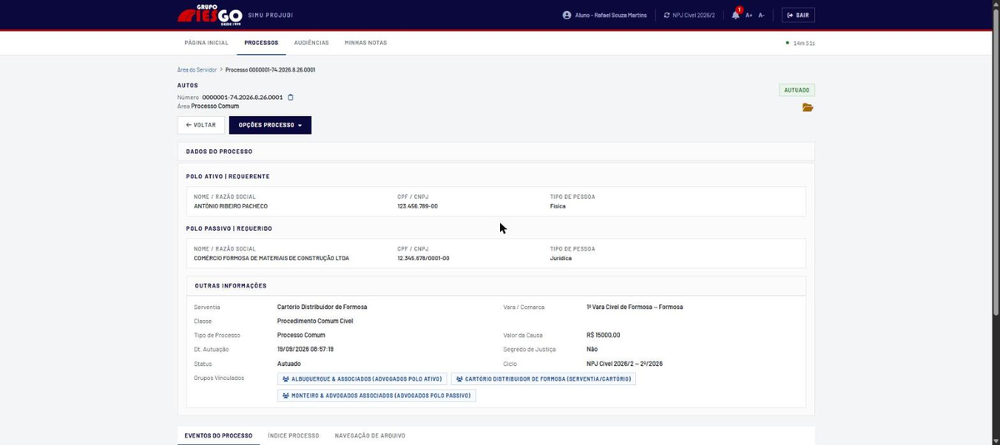

> ℹ️ Como consequência, **todo processo que vai envolver mais de um grupo** (por exemplo, uma ação
> com advogados dos dois polos) depende de existir, no ciclo, pelo menos um grupo com o papel
> "Serventia/Cartório" e pelo menos um aluno vinculado a ele; sem isso, não há como atribuir o
> segundo grupo pela interface.

---

## Capítulo de Serventia/Cartório (SC)

*Disponível para: Aluno vinculado a um grupo com papel processual **Serventia/Cartório**. É um
papel "de bastidor": faz o serviço cartorário/administrativo do processo (autuação, custas,
citação, expedientes, arquivamento), não é parte nem advogado de nenhum polo.*

Toda a navegação básica (Área do Aluno, menu Processos/Audiências/Minhas Notas, notificações) é a
mesma descrita no [Capítulo do Aluno](#capitulo-aluno). O que diferencia o papel Serventia/Cartório
são quatro pontos, cobertos abaixo.

### 1. O que muda na Área do Aluno para quem é Serventia/Cartório

Em vez de listar só os processos do próprio grupo, a Área do Aluno de um usuário SC mostra, em
**"Processos da Vara"**, **todos os processos do ciclo** (com uma coluna de checkbox e uma coluna
"Ações" que os outros papéis não têm): é essa visão ampliada que permite ao SC atuar em qualquer
processo, mesmo nos que seu grupo não está diretamente vinculado.

### 2. Vincular um Grupo a um Processo

Este é o fluxo mais importante do papel: atribuir (ou remover) o grupo de Polo Ativo, Polo Passivo
ou outro SC de um processo. Já está descrito em detalhe, com prints, na seção [12 do Capítulo do
Aluno](#aluno-sc-vincular-grupo); os passos são os mesmos, só reproduzidos lá por terem sido
escritos antes deste capítulo existir.

### 3. Modificar Dados do Processo e Alterar Parte

Para qualquer outro papel, a opção **"Modificar Dados"** do menu "Opções Processo" aparece
desabilitada (ver [seção 8 do Capítulo do Aluno](#aluno-detalhe-processo)). Para o SC, ela é a
única forma de corrigir os dados cadastrais depois que o processo já foi protocolado.

1. Na tela do processo, abra **Opções Processo → Modificar Dados**.
2. Altere **Comarca**, **Vara/Serventia**, **Tipo de Processo**, **Classe Processual**, **Valor da
   Causa** e/ou **Segredo de Justiça**.
3. Clique em **Salvar**.

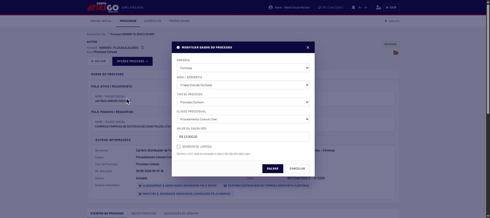

> ℹ️ O número do processo, o ciclo, a data de autuação e o status **não são alterados** por essa
> tela (aviso que aparece no rodapé do próprio modal).

Para corrigir os dados de uma das partes já cadastradas no processo (nome/razão social, CPF/CNPJ,
tipo de pessoa), use **Opções Processo → Partes → Alterar Parte**:

1. Escolha a parte no seletor **"Parte do Processo"** (mostra o polo de cada uma, ex.: "Ativo:
   Antônio Ribeiro Pacheco").
2. Altere os campos desejados.
3. Clique em **Salvar**.

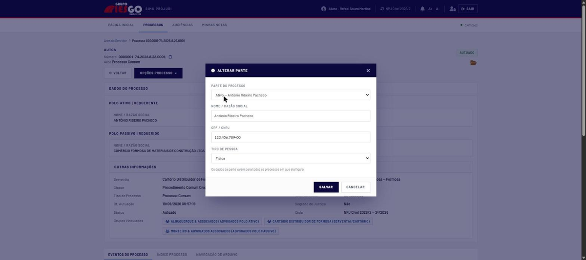

> ⚠️ O próprio modal avisa: **"Os dados da parte valem para todos os processos em que ela
> figura."** Como uma mesma Parte Fictícia pode estar cadastrada em vários processos diferentes, a
> alteração não fica restrita ao processo aberto no momento.

### 4. Movimentar Processo como Serventia/Cartório

O mecanismo de "Movimentar" é o mesmo explicado na [seção 9 do Capítulo do
Aluno](#aluno-movimentar-processo): um formulário de 2 passos, com o **Tipo de Movimentação** numa
lista suspensa. A diferença é **quais tipos aparecem**: para o SC, a lista reúne os atos cartorários
do fluxo processual: entre eles **Autuação e Distribuição**, **Custas Recolhidas**, **Custas Não
Recolhidas**, as diferentes **Modalidades de Citação** (Mandado, Postal, Edital, Eletrônica) e seus
desdobramentos, **Revelia**, **Laudo Pericial juntado**, **Publicação/Intimação das Partes**,
**Remessa ao 2º Grau**, **Trânsito em Julgado**, **Certidão de Trânsito em Julgado**,
**Arquivamento** e o transversal **Cancelamento/Tornar Sem Efeito** (disponível a qualquer momento,
sem pré-condição). Cada um só aparece quando sua pré-condição já foi cumprida por uma movimentação
anterior no mesmo processo; por isso a lista cresce/diminui conforme o processo avança.

Testado ao vivo: com o processo já **Autuado**, registrei a movimentação **"Custas Recolhidas"**
(Passo 1 → descrição → Avançar → Passo 2 de revisão → Confirmar Movimentação). O evento aparece
imediatamente na aba "Eventos do Processo", numerado em sequência, com usuário e data/hora, e ganha
um ícone de lápis (só quem registrou pode editar depois).

> ℹ️ Os campos de filtro por tipo de evento e a caixa "Bloquear/Desbloquear", acima da lista de
> eventos, aparecem sempre desmarcados/travados: são elementos visuais que reproduzem a tela do
> PROJUDI real, mas **não têm nenhuma função** implementada no simulador.

> ⚠️ **Não testei ao vivo** os demais tipos de movimentação exclusivos do SC (citação em suas
> variantes, revelia, publicação/intimação, remessa ao 2º grau, trânsito em julgado, arquivamento):
> o comportamento de cada um (avanço de status, notificações, prazos) segue o mesmo mecanismo já
> confirmado com "Custas Recolhidas" e "Autuação e Distribuição", mas a lista completa de
> pré-condições vem apenas do código (migração `0004_popular_catalogo_movimentacao`), não de teste
> passo a passo de cada ato.

---

## Capítulo de Advogados Polo Ativo (APA)

*Disponível para: Aluno vinculado a um grupo com papel processual **Advogados Polo Ativo**. É o
advogado de quem propôs a ação (o Requerente).*

A navegação (Área do Aluno, menus, notificações, cadastrar processo, anexar documento, editor
on-line) é toda a mesma do [Capítulo do Aluno](#capitulo-aluno). O que é específico do papel:

### 1. O que o APA não pode fazer

Confirmado ao vivo (login como Mariana Albuquerque Teixeira, grupo "Albuquerque & Associados"): no
menu "Opções Processo", **"Modificar Dados"** e **"Partes → Alterar Parte"** aparecem
**desabilitados**: essas duas ações são exclusivas do papel [Serventia/Cartório](#sc-modificar-dados).

### 2. Quais movimentações o APA pode praticar

Como em qualquer papel, a lista do formulário "Movimentar" (explicado na [seção 9 do Capítulo do
Aluno](#aluno-movimentar-processo)) só mostra os tipos cuja pré-condição já foi cumprida no
processo. Testado ao vivo: num processo recém-autuado, só **"Juntada de Documentos"** aparecia
disponível (o transversal, sem pré-condição).

Pelo código (migração `0004_popular_catalogo_movimentacao`, não testado ato a ato), o papel APA
está autorizado, mais à frente no processo, para: **Emenda Apresentada**, **Réplica do Autor**,
**Memoriais/Alegações Finais**, **Embargos de Declaração**, **Apelação**, **Contrarrazões**,
**Recurso Superior? (STJ/STF)** e **REsp/RE (STJ/STF)**, cada uma na fase correspondente do
processo (emenda da inicial, após a contestação do réu, fase recursal etc.).

---

## Capítulo de Advogados Polo Passivo (APP)

*Disponível para: Aluno vinculado a um grupo com papel processual **Advogados Polo Passivo**. É o
advogado de quem está sendo processado (o Requerido).*

Assim como o APA, a navegação geral é a do [Capítulo do Aluno](#capitulo-aluno), com as mesmas duas
restrições confirmadas para o APA: **"Modificar Dados"** e **"Alterar Parte"** ficam desabilitados
(ação exclusiva do [SC](#sc-modificar-dados)); não testado ao vivo separadamente para o APP porque
o comportamento é idêntico ao do APA e vem da mesma checagem de permissão
(`pode_editar_processo`), sem distinção entre os dois papéis de advogado.

### 1. Quais movimentações o APP pode praticar

Pelo código (migração `0004_popular_catalogo_movimentacao`, não testado ao vivo): o papel APP está
autorizado para **Contestação** (ação exclusiva dele, disponível depois da "Audiência de
Conciliação: Sem Acordo", e só quando o próprio grupo ocupa o Polo Passivo do processo),
**Réplica do Autor**, **Memoriais/Alegações Finais**, **Embargos de Declaração**, **Apelação**,
**Contrarrazões**, **Recurso Superior? (STJ/STF)**, **REsp/RE (STJ/STF)** e o transversal
**Juntada de Documentos**, disponível a qualquer momento.

> ℹ️ O nome "Réplica do Autor" aparecer também na lista do APP (e não só do APA) é assim no
> catálogo do sistema (`movimentacoes/migrations/0004_popular_catalogo_movimentacao.py`); este
> manual descreve o comportamento implementado, não avalia se o nome do ato bate com a prática
> forense real.

---

## Capítulo do Ministério Público (MP)

*Disponível para: Aluno vinculado a um grupo com papel processual **Ministério Público**. Atua
como fiscal da lei (custos legis), intervindo no processo quando a lei ou o juiz exigir.*

A navegação geral (Área do Aluno, "Processos Vinculados", menus, notificações, cadastrar processo,
anexar documento, editor on-line) é a mesma do [Capítulo do Aluno](#capitulo-aluno). O que é
específico do papel:

### 1. Restrições

Testado ao vivo (grupo "Promotoria de Justiça de Formosa", papel Ministério Público, vinculado ao
mesmo processo de teste usado nos demais capítulos): no menu "Opções Processo", **"Modificar
Dados"** também aparece desabilitado, como para os demais papéis de Aluno que não são
[Serventia/Cartório](#sc-modificar-dados).

### 2. Quais movimentações o MP pode praticar

Testado ao vivo: num processo recém-autuado, só **"Juntada de Documentos"** aparecia disponível no
formulário "Movimentar" (o transversal, sem pré-condição, igual ao observado para
[APA](#apa-movimentar) e [APP](#app-movimentar)).

Pelo código (migração `0004_popular_catalogo_movimentacao`, não testado ato a ato: exigiria
avançar o processo até a fase de réplica), o papel MP está autorizado, mais à frente no processo,
para:

- **Emenda Apresentada** (na fase de emenda da inicial).
- **Réplica do Autor** (depois da contestação do réu, junto com APA e APP).
- **Manifestação do MP** (ação exclusiva do MP, disponível quando o Juiz decide, na movimentação
  "MP Deve Intervir: Sim", que a intervenção do Ministério Público é obrigatória no processo).
- **Memoriais/Alegações Finais**, **Embargos de Declaração**, **Apelação**, **Contrarrazões**,
  **Recurso Superior? (STJ/STF)** e **REsp/RE (STJ/STF)**, nas fases de instrução e recursal,
  junto com APA e APP.

> ℹ️ A intervenção do MP no processo é decidida pelo [Juiz](#capitulo-jz), na movimentação "MP
> Deve Intervir: Sim/Não". Só quando o Juiz escolhe "Sim" é que "Manifestação do MP" passa a
> aparecer na lista de movimentações desse papel.

---

## Capítulo do Juiz (JZ)

*Disponível para: Aluno vinculado a um grupo com papel processual **Juiz**. Conduz o processo:
decide, saneia, julga e sentencia.*

A navegação geral (Área do Aluno, "Processos Vinculados", menus, notificações) é a mesma do
[Capítulo do Aluno](#capitulo-aluno). O papel de Juiz é o que mais movimentações tem no catálogo do
sistema: praticamente toda a condução do processo (despachos, decisões e sentença) é dele. O que
é específico do papel:

### 1. Restrições

Testado ao vivo (grupo "1ª Vara Cível de Formosa", papel Juiz, vinculado ao mesmo processo de
teste): assim como para os demais papéis de Aluno, **"Modificar Dados"** aparece desabilitado no
menu "Opções Processo": essa ação continua exclusiva do papel [Serventia/Cartório](#sc-modificar-dados),
mesmo para quem julga o processo.

### 2. Quais movimentações o Juiz pode praticar

Testado ao vivo: num processo recém-autuado (antes de qualquer despacho de citação), só
**"Desentranhamento"** aparecia disponível no formulário "Movimentar" (o transversal exclusivo do
Juiz, sem pré-condição).

Pelo código (migração `0004_popular_catalogo_movimentacao`, não testado ato a ato: o processo de
teste usado neste manual não foi avançado por toda a instrução), o papel Juiz é autorizado, em
cada fase do processo, para uma sequência bem mais longa de movimentações do que os demais papéis.
Agrupando por fase:

- **Análise da inicial**: Cancelamento da Distribuição, Análise da Inicial (Irregular / Urgente /
  Indefere / Em Ordem), Indeferimento da Inicial, Despacho de Citação.
- **Tutela de urgência**: Tutela de Urgência Deferida/Indeferida, Liminar Concedida.
- **Citação**: nova tentativa de citação por edital, quando a citação anterior não teve êxito.
- **Audiência de conciliação**: resultado da audiência, com ou sem acordo.
- **Revelia**: efeitos da revelia (produz ou não efeito) e Julgamento Antecipado.
- **Intervenção do MP**: decisão se o MP deve intervir (Sim/Não) e Decisão Saneadora.
- **Instrução**: Provas a Produzir (Perícia / Prova Oral / Só Documental), Audiência de Instrução
  e Julgamento, Resultado da Audiência (Acordo / Memoriais / Julgamento na Data), Acordo em
  Audiência.
- **Sentença**: Sentença Homologatória de Acordo, Sentença, Tipo de Sentença (Com Mérito / Sem
  Mérito), Com/Sem resolução do mérito.
- **Fase recursal**: Decisão nos Embargos.
- **Transversal**: Desentranhamento, disponível a qualquer momento (testado ao vivo acima).

> ℹ️ Esta lista foi organizada por fase para facilitar a leitura; a ordem exata e as
> pré-condições de cada movimentação (o que precisa ter acontecido antes no processo para que ela
> apareça disponível) estão definidas no catálogo do sistema
> (`movimentacoes/migrations/0004_popular_catalogo_movimentacao.py`), não neste manual.

---

## Notificações do Sistema

*Disponível para todos os perfis.*

O sino de notificações, no canto superior direito de qualquer tela logada, mostra um contador
vermelho com a quantidade de notificações não lidas. Clicar nele abre um menu com as notificações
mais recentes (data relativa, ex. "6 minutos atrás") e um link **"Ver todas"**, que leva à página
completa `/notificacoes/`. Os exemplos de notificação do Aluno (vínculo ao ciclo, grupo vinculado a
um processo, nova movimentação) estão na seção ["Minhas Notas"/"Notificações" do Capítulo do
Aluno](#capitulo-aluno).

O conteúdo muda conforme o perfil logado: por exemplo, o **Professor/Coordenador** recebe
notificação ao ser designado responsável (coordenador) por um ciclo ("Você foi designado
coordenador do ciclo '...'"):

> ⚠️ Nem toda ação gera notificação: **atribuir uma nota a uma movimentação não gera nenhuma
> notificação** para o aluno avaliado; o aluno só fica sabendo da nota abrindo a tela "Minhas
> Notas" manualmente. Da mesma forma, uma nova movimentação de um aluno não gera notificação
> visível para o Professor responsável pelo ciclo.

---

*(Próximos capítulos: capítulo dos perfis Serventia/Cartório, Ministério Público e Juiz;
"Distribuir Novo Processo" e "Agendar Audiência" do Professor; revisão geral do manual e Apêndice
de capturas de tela em produção.)*
